# 02 · Requirements Specification (SRS)

| | |
|---|---|
| Document | SpeedLimit MVP – Software Requirements Specification |
| Version | 0.1 |
| Date | 2026-11-10 |
| Status | Draft |
| Owner | Requirements Engineering |
| Course / case | SE4AI, case study "SpeedLimit" (ExID SpeedLimit21) |
| Binding inputs | Lecturer slides 3–19 and 32, decision log `05-decision-log.md` (D1–D20), verified figures `figures/facts.json` |

Conventions: **shall** = mandatory, **should** = desired, **may** = optional. "Per Dx" refers to the decision log. All data numbers come from `facts.json` (data year N, January, 744 hours). Target values that are design choices, not data facts, are marked *(target)* and backed by an assumption.

---

## 1. Purpose and scope

### 1.1 Purpose

The highway operator wants the speed limit on one highway section to be set automatically. The default limit is 80 km/h. A neural network (NN) decides how far to reduce it when it is dark or there is danger of black ice. An LLM decides about a reduction when poor air quality is forecast. This document turns the lecturer's REQ1–REQ3 and SPEC1–SPEC4 into testable requirements, adds the missing ones, and records the assumptions we made instead of asking the lecturer (decision-log rule).

### 1.2 Scope of the MVP

| In scope | Out of scope |
|---|---|
| Training stage: load, repair and transform the CSV data (D19), train a small NN (MLPRegressor, D18) on near-accidents per hour (D7) | Real sensor hardware or live sensor feeds (slide 32) |
| Operational stage: Streamlit GUI with manual inputs and optional CSV replay timer (D17) | Deployment to a high-performance or production environment (slide 32) |
| Deterministic condition rules for dark / black ice (D5) | Driving physical variable message signs |
| REQ2 path: Open-Meteo air-quality forecast + LLM with deterministic fallback (D14, D15) | Multi-section or network-wide coordination |
| Combination of reasons (D16), decision logging, explanation in GUI | Other reduction reasons (fog, roadworks, congestion, wind) |
| Drift check on year N+1 data (D13) | Automatic retraining pipeline (only the check and a verdict) |
| Final management presentation incl. lessons learned (slide 32) | User management / authentication |

### 1.3 Context diagram

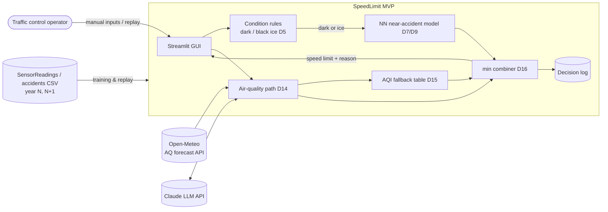

---

## 2. Stakeholders

| ID | Stakeholder | Role | Interest | Influence | Key concern |
|---|---|---|---|---|---|
| SH-01 | Highway operator management | Sponsor, owner of the system | Fewer near-accidents, reputation, cost | High | Does the system meet REQ1? Business case, liability |
| SH-02 | Traffic control operators | Primary users of the GUI | Clear, quick recommendation they can trust | Medium | Understandable reason, override possible, no false alarms |
| SH-03 | Drivers / road users | Affected by the limit | Safety, travel time, consistent limits | Low (indirect, via complaints/politics) | Limits must be plausible; no unexplained reductions (D10) |
| SH-04 | Police / emergency services | Enforce limits, respond to incidents | Enforceable, documented limits | Medium | Every limit traceable with time and reason (audit) |
| SH-05 | Road maintenance / winter service | Treat roads against ice | Coordinate gritting with black-ice periods | Low | Black-ice rule (SPEC2) consistent with their own triggers |
| SH-06 | Environmental authority | Regulator for air quality | Reductions when air quality is poor | Medium–High | REQ2 thresholds aligned to EU AQI bands |
| SH-07 | Data protection officer | GDPR compliance | Minimal personal data | High (can block) | `LicencePlate` must never be processed or stored (D20) |
| SH-08 | Transport ministry / road authority | Legal framework for limits | Limits within legal values and steps | High | Only legal limit values (40–80 step 10) |
| SH-09 | IT operations | Run the tool | Simple stack, few dependencies | Medium | External API keys, outages, logs (D15, D18) |
| SH-10 | Data science / dev team | Build and maintain | Clean data, clear spec | Medium | Data barely supports REQ1 (F04, D8) |
| SH-11 | Insurance companies | Cover accidents on the highway | Lower accident rate, evidence | Low | Documented decisions after an incident |
| SH-12 | LLM / API providers (Anthropic, Open-Meteo) | External services | Fair use of their APIs | Low | Rate limits, terms of use, availability |
| SH-13 | Lecturer / assessor | Evaluates the project | All exercises covered, defensible decisions | High | RE quality, traceability, lessons learned |
| SH-14 | Sensor vendor / sensor maintenance | Keeps sensors working | Detect faulty sensors | Low | Sensor spread used as quality signal (D4) |

---

## 3. Glossary

| Term | Definition in this project |
|---|---|
| Hour (reading hour) | Clock hour 0–23 of a sensor reading. Accident `Hour` 1–24 is mapped to reading hour `Hour − 1` (D1). |
| Illuminance | Light level measured by the light sensors, in lux (lx). 500 millilux = 0.5 lx. |
| Dark | Mean illuminance of all working light sensors in the hour < 0.5 lx (SPEC1, D4, D5). |
| Road water film | Water depth on the road surface in micrometres (µm), from the water sensors. |
| Black-ice danger | Mean water film > 1000 µm **and** mean temperature < 0 °C in the same hour (SPEC2, D5). |
| Reduction condition (REQ1) | Dark **or** black-ice danger. |
| Normal conditions | Not dark, no black-ice danger, and no poor air quality forecast. |
| Near-accident | A logged event in `accidents.csv` with `CloseCarCm`, `CloseGuardrailCm` or `SkidAngle` set (SPEC4, D6). Every logged event counts; no extra distance threshold. |
| Accident | A logged event with `Damage` (EUR) or `Injured` (persons) set. Reported separately, not the REQ1 target (D6). |
| Near-accident rate | Number of near-accidents in one reading hour on the highway section. |
| "On average" (REQ1) | The model's predicted expected near-accident count per hour for the given conditions and limit (D7). |
| Speed limit sensor (−1) | Pseudo-sensor with `sensorID = −1` in `SensorReadings.csv`; its value is the speed limit in km/h in force at that time (slide 6). |
| Candidate limits | The legal limit values the system may output: {40, 50, 60, 70, 80} km/h (D7, D14). |
| Default limit | 80 km/h (REQ3). |
| AQI | European Air Quality Index (dimensionless, 0 to >100) as returned by Open-Meteo (D14). |
| Poor air quality | Forecast European AQI > 60 for the decision horizon (A-08, D15). |
| Air-quality forecast | Hourly forecast from the Open-Meteo Air-Quality API for the highway location (D14). |
| LLM path | REQ2 decision made by an LLM from the air-quality forecast, returning JSON `{speed_limit, reason}` (D14). |
| Fallback table | Deterministic AQI → limit table used when the LLM path fails (D15). |
| Target-not-reachable flag | Set when no candidate limit gives a predicted rate ≤ 1.0 near-accidents/h (D7). |
| Monotonicity guard | Post-processing that forbids the predicted rate from rising when the limit is lowered (D9). |
| Drift check | Per-feature distribution comparison between training year N and a new year (D13). |
| Decision cycle | One evaluation of all rules producing one final limit; triggered by input change or timer (D17). |
| MVP | Minimum viable product: GUI-driven, no real sensors, no production deployment (slide 32). |

---

## 4. Assumptions

Each assumption replaces a question we would otherwise have asked the lecturer.

| ID | Assumption | Decision |
|---|---|---|
| A-01 | Accident `Hour` h belongs to the reading hour h − 1. | D1 |
| A-02 | Sensor type `T` means temperature for sensors 15, 18, 19 and traffic (cars/s) for sensor 16. | D2 |
| A-03 | Undocumented sensor 19 is a temperature sensor; sensors 7, 10, 17 (no readings) are ignored. | D3 |
| A-04 | Redundant sensors of one type are combined by the hourly mean; the spread is kept as a quality signal. | D4 |
| A-05 | "Dark" and "black ice" are evaluated on the aggregated hourly values, by deterministic code, not by the NN. | D5 |
| A-06 | Slide 3's "bad weather" is narrowed to "danger of black ice" as in REQ1/SPEC2. Other bad weather (rain, wind, fog) does not trigger REQ1 in the MVP. | D5 |
| A-07 | Every logged near-accident event counts; accidents are not part of the REQ1 target. | D6 |
| A-08 | "Poor air quality" = forecast European AQI > 60 (EU band "poor" or worse). Open-Meteo forecast is used because REQ2 says "predicted". | D14, D15 |
| A-09 | "On average" in REQ1 = the expected (predicted mean) count per hour for the current conditions and chosen limit, not a running average over observed hours. | D7 |
| A-10 | Legal limits are 40–80 km/h in 10 km/h steps; the system never outputs other values. | D7, D14 |
| A-11 | When several reasons apply, the lowest limit wins. | D16 |
| A-12 | "Set on a regular basis" = recomputed on every GUI input change and on a timer in replay mode. Default timer: every 60 min of replayed data *(target)*, since readings are hourly (slide 6). | D17 |
| A-13 | REQ1 is built as specified although the data barely supports it; the limitation is reported openly. | D8 |
| A-14 | Lowering the limit never increases risk (domain assumption against confounding). | D9 |
| A-15 | The 28 "normal but < 80 km/h" hours are real but unexplained operator choices; they stay in training and are never reproduced at runtime. | D10 |
| A-16 | Model features are the set in D11; month, minute/second and licence plate are not inputs. | D11 |
| A-17 | Generalisation is measured with a day-based split (days 1–24 train, 25–31 test). | D12 |
| A-18 | The year N+1 file is used for a drift check only. | D13 |
| A-19 | An external service failure must not leave the limit undefined; the fallback table applies. LLM/API timeout: 10 s *(target)*. | D15 |
| A-20 | Licence plates are personal data and are not needed. | D20 |
| A-21 | The highway section is a single location; one set of aggregated sensor values and one limit apply to the whole section. | D4 |
| A-22 | The operator remains responsible for the limit; the MVP is a decision-support tool, and the GUI output is a recommendation that the operator can see the reason for. | D8, D17 |
| A-23 | The data repairs on slide 17 are implemented even where V100 does not contain the fault. | D19 |

---

## 5. System requirements

Original wording is kept for traceability. REQ1–REQ3 are rewritten; REQ4+ are new.

| ID | Original (slide 9) | Rewritten requirement | Priority | Source |
|---|---|---|---|---|
| REQ1 | "When it is dark or there is danger of black ice the speed limit on the highway shall be reduced in such a way that there will be on average at most one near-accident per hour." | When the reduction condition (dark **or** black-ice danger, SPEC1/SPEC2) holds in a decision cycle, the system **shall** set the REQ1 limit to the highest candidate limit whose predicted near-accident rate is ≤ 1.0 per hour. If no candidate limit meets this, the system **shall** set the candidate limit with the lowest predicted rate and raise the target-not-reachable flag. | Must | slide 9, D5, D7, D8 |
| REQ2 | "When poor air quality is predicted the speed limit on the highway shall be reduced in an appropriate way." | When the air-quality forecast for the next decision hour shows poor air quality (European AQI > 60), the system **shall** determine a REQ2 limit from {40, 50, 60, 70} km/h via the LLM path, together with a textual reason. When the forecast AQI ≤ 60, the REQ2 path **shall not** reduce the limit. | Must | slide 9, D14, A-08 |
| REQ3 | "If there is no reason to reduce the speed limit because of REQ1 or REQ2, it is set to 80 km/h." | When neither the REQ1 reduction condition nor poor air quality applies, the system **shall** set the final limit to 80 km/h. | Must | slide 9, D10 |
| REQ4 | — (missing: combination) | When more than one reason applies, the final limit **shall** be the minimum of the applicable limits and 80 km/h (D16). The GUI **shall** show which reason determined the final limit. | Must | D16 |
| REQ5 | — (missing: fallback) | If the air-quality API or LLM fails, exceeds the timeout, or returns output that is not valid JSON with `speed_limit ∈ {40,50,60,70,80}`, the system **shall** use the fallback table (SPEC-12) and show "fallback" as the REQ2 source. | Must | D15 |
| REQ6 | — (missing: audit) | For every decision cycle the system **shall** log: timestamp, input values, condition flags, NN predictions per candidate limit, REQ2 source (LLM / fallback) with limit and reason, final limit, flags, and model version. | Must | SH-04, SH-11 |
| REQ7 | — (missing: training stage) | The system **shall** provide a reproducible training stage that repairs and transforms the raw CSV data (SPEC-15) and trains the NN on near-accidents per hour (SPEC3). | Must | slide 32, D7, D19 |
| REQ8 | — (missing: operational stage) | The system **shall** provide a GUI in which an operator enters the sensor parameters of SPEC-14 (or replays them from CSV) and sees the resulting limit, reason, predicted rate and flags. | Must | slide 32, D17 |
| REQ9 | — (missing: retraining) | The system **shall** provide a drift check that compares a new year's readings with the training year per feature and outputs a retrain / no-retrain verdict. | Must | slide 19, D13 |
| REQ10 | — (missing: output domain) | The final limit **shall** always be one of {40, 50, 60, 70, 80} km/h; in normal conditions it **shall** be 80 km/h, irrespective of past operator behaviour. | Must | D7, D10 |
| REQ11 | — (missing: transparency) | The system **shall** report the model's real test error and the REQ1 data limitation (F04) in the GUI and in the management presentation. | Must | D8 |
| REQ12 | — (missing: data quality reporting) | The training stage **shall** produce a data report listing all detected faults and repairs, including the 28 unexplained reductions. | Should | D10, D19 |
| REQ13 | — (missing: accidents) | The system **should** report accidents (Damage / Injured) separately from near-accidents in the data report. | Should | D6 |

---

## 6. Requirement specifications

### 6.1 Completed original specifications

| ID | Original (slide 11) | Completed specification |
|---|---|---|
| SPEC1 | "It is dark when the illuminance is below 500 millilux." | It is dark in an hour when the mean illuminance of the available light sensors (2, 9, 12) is < 0.5 lx. Exactly 0.5 lx is *not* dark. If all light sensors are missing for the hour, the hour is treated as dark (fail-safe). |
| SPEC2 | "There is danger of black ice if there is more than 1000 micrometers water on the road and the temperature is below zero degrees Celsius." | There is black-ice danger in an hour when the mean water film of sensors 1, 8, 11 is > 1000 µm **and** the mean temperature of sensors 15, 18, 19 is < 0 °C. Boundary values (1000 µm, 0 °C) do not trigger. If either value is missing, the last valid hourly value is used; if none exists, black-ice danger is assumed (fail-safe). |
| SPEC3 | "A neural network shall learn from sensor data how weather, current speed limit and the number of near-accidents are connected." | An MLP regressor shall learn `near_accidents_per_hour = f(features of SPEC-07, speed_limit)` from the hourly training table (count regression, D7). Prediction output ≥ 0. Training on days 1–24, test on days 25–31 (D12). |
| SPEC4 | "A near-accident is defined as a car skidding or getting too close to another car or the highway guardrail." | A near-accident is a row in `accidents.csv` with a value in `CloseCarCm` (too close to a car), `CloseGuardrailCm` (too close to the guardrail) or `SkidAngle` (skidding). No minimum distance or angle is applied; all logged events count (D6). Rows with only `Damage`/`Injured` are accidents. Rows with no field set are dropped. |

### 6.2 New specifications

| ID | Specification | Decision |
|---|---|---|
| SPEC-05 Units | Illuminance lx; water µm; temperature °C; humidity % (as in Sensors.csv); noise dB (as in Sensors.csv); wind strength as in Sensors.csv; wind direction degrees 0–360; traffic cars/s; speed km/h; AQI dimensionless. | D2, D11 |
| SPEC-06 Sensor aggregation | Per hour and sensor type, the value is the mean of the available sensors: water 1/8/11, light 2/9/12, noise 3 (10 has no readings), wind direction 5/13 (circular), wind strength 6/14, temperature 15/18/19, traffic 16. The per-type standard deviation is stored as a quality signal. Sensors 7, 10, 17 are ignored. | D3, D4 |
| SPEC-07 Feature set | NN inputs: log10(lux), water, temperature, humidity, noise, wind strength, sin/cos(wind direction), traffic, sin/cos(hour of day), speed limit. Not used: month, minute, second, LicencePlate. | D11, F08 |
| SPEC-08 Target | Count of near-accidents per reading hour after the D1 hour mapping. Hours without events have target 0. | D1, D6 |
| SPEC-09 Candidate evaluation | At runtime the NN is evaluated for each candidate in {80, 70, 60, 50, 40}; predictions are post-processed with a running minimum over descending limits (D9). The REQ1 limit is the highest candidate with prediction ≤ 1.0; otherwise the arg-min with flag. | D7, D9 |
| SPEC-10 Condition gating | The NN is only consulted when SPEC1 or SPEC2 holds. Otherwise the REQ1 limit is "not applicable" (= 80 for the combiner). | D5 |
| SPEC-11 Air-quality input | Open-Meteo Air-Quality forecast API, no key, for the highway coordinates; fields: european_aqi, pm2_5, pm10, nitrogen_dioxide, ozone; the value for the next full hour is used. | D14 |
| SPEC-12 LLM contract & fallback | Fixed prompt; the LLM must return JSON `{"speed_limit": int, "reason": str}` with `speed_limit ∈ {40,50,60,70,80}`. Any other output = invalid. Fallback table: AQI ≤ 60 → 80; 61–80 → 70; 81–100 → 60; > 100 → 50. | D14, D15 |
| SPEC-13 Combiner | `final = min(REQ1_limit if dark or ice, REQ2_limit if AQI > 60, 80)`. Ties report all determining reasons. | D16 |
| SPEC-14 GUI inputs | Lux, water (µm), temperature (°C), humidity, noise, wind strength, wind direction, traffic, hour of day, current speed limit; air-quality fetched or entered manually. Pre-filled from a sample hour; replay mode reads hours from CSV in order. | D17 |
| SPEC-15 Data repairs | Pipeline repairs: missing values, text months ("January" → 1), NULL month, out-of-range values (e.g. wind direction > 360), duplicated readings, missing sensor IDs; each repair has a unit test with an injected fault. | D19, F12 |
| SPEC-16 Privacy at load | `LicencePlate` column is dropped in the loader before any other processing and is never written to disk or logs. | D20 |
| SPEC-17 Drift check | For each SPEC-07 feature: two-sample KS test plus mean shift between year N and the new year. Verdict "retrain" if any feature shows a significant shift (α = 0.05 *(target)*), else "no retrain". | D13, F10 |
| SPEC-18 Model artefact | The trained model is saved with a version ID, training data hash, feature list, random seed and test metrics. | REQ6, NFR-ML |

---

## 7. Non-functional requirements

| ID | Category | Requirement | Measure / fit criterion |
|---|---|---|---|
| NFR-01 | Safety | The system shall never output a limit above 80 km/h or outside {40..80 step 10}. | 0 violations over all test cases and all 744 replayed hours |
| NFR-02 | Safety | Missing or implausible inputs shall lead to the more restrictive interpretation (fail-safe, SPEC1/SPEC2). | Test with missing light / water / temperature values |
| NFR-03 | Safety | Lowering the limit shall never increase the predicted near-accident rate (D9). | Predictions non-increasing over descending limits for every test hour |
| NFR-04 | Safety | In normal conditions the output shall be 80 km/h, including the 28 hours where operators historically chose less (D10). | 28/28 replayed hours → 80 |
| NFR-05 | Explainability | Every output shall show the determining reason(s), condition flags, predicted rate per candidate, REQ2 source and the target-not-reachable flag. | GUI review checklist; all fields present |
| NFR-06 | Explainability | The REQ2 decision shall include a human-readable reason (≤ 300 characters *(target)*). | Schema validation |
| NFR-07 | Privacy | No personal data (LicencePlate) shall be read into the model data, persisted or logged (D20). | Grep of all outputs/logs for the column; unit test |
| NFR-08 | Reliability (LLM path) | A failure, timeout (10 s *(target)*) or invalid output of the API/LLM shall still produce a valid limit via the fallback table within the same decision cycle (D15). | Fault-injection tests: 100 % fallback success |
| NFR-09 | Availability | The REQ1 and REQ3 paths shall work without network access. | Run GUI with network disabled |
| NFR-10 | Performance (MVP) | A decision cycle without the LLM call shall complete in ≤ 2 s *(target)* on a standard laptop; training shall complete in ≤ 5 min *(target)*. | Timed test |
| NFR-11 | Usability | An operator shall be able to change one input and read the new limit and reason without leaving the main screen; inputs show units and valid ranges. | Walk-through with 2 non-developer testers |
| NFR-12 | Usability | The GUI shall clearly distinguish recommended limit, reason, and warnings (flag, fallback in use). | GUI review |
| NFR-13 | Data quality | Each detected data fault shall be logged with sensor, time, fault type and repair action. | Data report present; F12 claims checked |
| NFR-14 | Data quality | Hours where redundant sensors disagree strongly (spread above a configured threshold) shall be flagged. | Unit test with injected deviating sensor |
| NFR-15 | ML – reproducibility | Training with the same data, config and seed shall yield identical metrics. | Two runs, identical test MAE |
| NFR-16 | ML – versioning | Each prediction shall be traceable to a model version (SPEC-18). | Model version present in every log entry |
| NFR-17 | ML – evaluation honesty | Test error shall be measured on the day-based hold-out (days 25–31) and compared with the baseline "mean rate per condition × limit" (D12). | Metrics table in report and deck |
| NFR-18 | ML – drift | The drift check shall be runnable from one command on any year file in the same format. | Run on year N+1 → verdict |
| NFR-19 | Maintainability | Thresholds (0.5 lx, 1000 µm, 0 °C, 1.0/h, AQI table, timeout) shall be configuration, not hard-coded in logic. | Code review |
| NFR-20 | Maintainability | Core logic (rules, combiner, fallback, repairs) shall be covered by pytest unit tests. | All tests green; each SPEC has ≥ 1 test |
| NFR-21 | Portability | The system shall run on Python 3.13 with the D18 stack only. | Fresh environment install |
| NFR-22 | Security | The LLM API key shall be read from an environment variable and never shown in the GUI or logs. | Grep logs; code review |

---

## 8. Acceptance criteria (Given / When / Then)

Unless stated, "other inputs" are taken from a normal daytime sample hour and AQI forecast = 30.

### REQ1 – dark / black ice

**AC-REQ1-01 (dark, target reachable)**
- Given lux = 0.3, water = 200 µm, temperature = 5 °C, AQI = 30
- And the (guarded) NN predicts 1.4 at 80, 1.2 at 70, 0.9 at 60, 0.8 at 50, 0.8 at 40
- When a decision cycle runs
- Then the condition "dark" is true, the REQ1 limit is 60 km/h, the final limit is 60 km/h, and the flag is not set.

**AC-REQ1-02 (black ice, not dark)**
- Given lux = 2000, water = 1200 µm, temperature = −2 °C, AQI = 30
- When a decision cycle runs
- Then "black ice" is true, "dark" is false, the NN is consulted and the final limit equals the REQ1 limit per SPEC-09.

**AC-REQ1-03 (target not reachable)**
- Given lux = 0.3 and the NN predicts > 1.0 for every candidate, lowest at 40 km/h
- When a decision cycle runs
- Then the REQ1 limit is 40 km/h and the GUI shows "target not reachable" with the predicted rate.

**AC-REQ1-04 (boundaries)**
- Given lux = 0.5, water = 1000 µm, temperature = 0 °C
- When a decision cycle runs
- Then neither "dark" nor "black ice" is true and the NN is not consulted.

**AC-REQ1-05 (water high but warm)**
- Given lux = 2000, water = 1200 µm, temperature = 3 °C, AQI = 30
- Then no REQ1 condition holds and the final limit is 80 km/h.

**AC-REQ1-06 (replay of year N)**
- Given the 744 hours of year N replayed
- When conditions are evaluated
- Then exactly 354 hours are dark, 62 hours have black-ice danger (35 of them not dark), and 389 hours trigger REQ1.

### REQ2 – air quality

**AC-REQ2-01 (poor air, LLM ok)**
- Given lux = 2000, water = 0 µm, temperature = 10 °C, forecast AQI = 85
- And the LLM returns `{"speed_limit": 60, "reason": "..."}`
- When a decision cycle runs
- Then the final limit is 60 km/h, REQ2 source = "LLM", and the reason is displayed.

**AC-REQ2-02 (good air)**
- Given forecast AQI = 45 and no REQ1 condition
- Then the REQ2 path does not reduce and the final limit is 80 km/h.

**AC-REQ2-03 (LLM output out of domain)**
- Given forecast AQI = 85 and the LLM returns `{"speed_limit": 65}`
- Then the output is rejected and the fallback table yields 60 km/h with source = "fallback".

### REQ3 – default

**AC-REQ3-01**
- Given lux = 2000, water = 200 µm, temperature = 5 °C, AQI = 30
- When a decision cycle runs
- Then the final limit is 80 km/h and the reason is "no reduction reason".

**AC-REQ3-02 (unexplained historic reductions)**
- Given the 28 year-N hours with normal conditions and historic limit 60 km/h
- When replayed
- Then the system outputs 80 km/h for all 28.

### REQ4 – combination

**AC-REQ4-01**
- Given lux = 0.3 (REQ1 limit 60) and forecast AQI = 110 (REQ2 limit 50)
- When a decision cycle runs
- Then the final limit is 50 km/h and the determining reason is "air quality".

**AC-REQ4-02**
- Given REQ1 limit 50 and REQ2 limit 70
- Then the final limit is 50 km/h and the determining reason is "dark / black ice".

### REQ5 – fallback

**AC-REQ5-01 (timeout)**
- Given forecast AQI = 75 and the LLM does not answer within 10 s
- Then the fallback table yields 70 km/h, source = "fallback", and the cycle completes.

**AC-REQ5-02 (API down)**
- Given the Open-Meteo API is unreachable and the operator enters AQI = 95 manually
- Then the REQ2 limit is 60 km/h from the fallback table, source = "fallback (manual AQI)".

### REQ6 – audit log

**AC-REQ6-01**
- Given any decision cycle
- Then one log entry exists containing all REQ6 fields, including model version, and no `LicencePlate` value.

### REQ7 – training

**AC-REQ7-01**
- Given the year-N CSV files
- When the training stage runs twice with the same seed
- Then the hourly table has 744 rows, 964 near-accidents and 32 accidents are counted, 1 empty event row is dropped, and both runs give identical test metrics.

### REQ8 – GUI

**AC-REQ8-01**
- Given the GUI is open with a pre-filled sample hour
- When the operator changes temperature from 5 °C to −2 °C with water = 1200 µm
- Then limit, reason and predicted rates update without a manual reload.

### REQ9 – drift check

**AC-REQ9-01**
- Given year N and year N+1 files (12 648 readings each)
- When the drift check runs
- Then no feature shows a shift and the verdict is "no retraining needed" (files identical, F10).

**AC-REQ9-02**
- Given a copy of year N+1 with temperature shifted by +5 °C
- Then the temperature feature is flagged and the verdict is "retrain".

### Key NFRs

**AC-NFR-01 (output domain)** — Given all 744 replayed hours and all AQI table bands, then every final limit ∈ {40, 50, 60, 70, 80}.

**AC-NFR-03 (monotonicity)** — Given a raw NN output of 0.9 at 70 and 1.1 at 60 for the same conditions, when the guard runs, then the guarded value at 60 is 0.9.

**AC-NFR-07 (privacy)** — Given an accidents file containing `LicencePlate`, when training and the GUI run, then no output file, log or model artefact contains the column or any plate value.

**AC-NFR-09 (offline)** — Given no network and lux = 0.3, then the REQ1 limit is computed, REQ2 uses manual AQI / fallback, and a valid limit is shown.

**AC-NFR-10 (performance)** — Given the trained model, when 100 decision cycles run without LLM, then each takes ≤ 2 s.

**AC-NFR-17 (honest evaluation)** — Given the day-based split, then the report shows NN test error next to the baseline error and states which is better.

---

## 9. Natural-language defects found in the original material

| # | Original text (source) | Defect type | Problem | Our fix |
|---|---|---|---|---|
| 1 | "only be used if it is dark or the weather is bad" (slide 3) vs "dark or there is danger of black ice" (REQ1) | Inconsistency | Two different trigger conditions for the NN. | Use REQ1/SPEC2 (black ice) only (A-06). |
| 2 | "current air quality (queried via API)" (slide 3) vs "poor air quality is predicted" (REQ2) | Inconsistency | Current vs forecast value. | Use a forecast API (D14, A-08). |
| 3 | "on average at most one near-accident per hour" (REQ1) | Ambiguity | Average over what: hours, days, conditions, the whole year? | Expected count per hour for given conditions and limit (A-09, D7). |
| 4 | "reduced in such a way that ..." (REQ1) | Incompleteness | No rule if the target cannot be met; no rule for choosing among several limits that meet it. | Highest compliant limit; else the highest limit within ε = 0.05/h of the lowest prediction, plus a flag (D7, D25). |
| 5 | "reduced in an appropriate way" (REQ2) | Untestable / vague | "Appropriate" has no criterion. | Candidate set, AQI band thresholds, JSON contract, fallback table (SPEC-12). |
| 6 | "poor air quality" (REQ2) | Undefined term | No index, no threshold. | European AQI > 60 (A-08). |
| 7 | "If there is no reason ... because of REQ1 or REQ2" (REQ3) | Incompleteness | Does not say what happens when both REQ1 and REQ2 apply. | min-combiner (REQ4, D16). |
| 8 | "the speed limit on the highway" (REQ1–3) | Ambiguity | Which section; one or many sensors per type? | Single section, mean of sensors (A-21, D4). |
| 9 | "below 500 millilux" (SPEC1) | Incompleteness | Which sensor, which aggregation, boundary, missing values? Unit differs from data (lux). | Mean of light sensors < 0.5 lx, boundary not dark, fail-safe on missing (SPEC1). |
| 10 | "more than 1000 micrometers water ... below zero degrees" (SPEC2) | Incompleteness | Aggregation and missing data not defined. | Mean values, fail-safe (SPEC2). |
| 11 | "learn ... how weather, current speed limit and the number of near-accidents are connected" (SPEC3) | Ambiguity / design-free | No input/output direction, no feature list, "weather" undefined. | Count regression f(features, limit) (D7, D11). |
| 12 | "getting too close" (SPEC4) | Vague | No distance threshold. | All logged events count (D6). |
| 13 | "Bad weather and darkness are not the only possible reasons" (slide 3) | Incompleteness | Open list of reasons. | MVP scope limited to dark, black ice, air quality (§1.2). |
| 14 | "it is set to 80 km/h" (REQ3) vs historic data with 28 normal-condition hours < 80 | Inconsistency (spec vs. data) | Data shows behaviour that REQ3 forbids. | Keep in training, never output (D10). |
| 15 | "at a regular basis" (slide 32) | Ambiguity | No interval. | On input change + timer (D17, A-12). |
| 16 | Sensor type "T" for temperature and traffic (slide 17, Sensors files) | Ambiguity in source data | Same code, two meanings. | D2. |
| 17 | REQ1 itself (slide 9) vs data | Infeasibility / unverifiable | Observed rate ≥ 1.04/h at every limit (F04). | §11, D8. |

---

## 10. Traceability matrix

| REQ | SPEC | Decisions | Planned tests | Evidence |
|---|---|---|---|---|
| REQ1 | SPEC1, SPEC2, SPEC3, SPEC-06, SPEC-07, SPEC-09, SPEC-10 | D4, D5, D7, D8, D9, D11 | TC-01 … TC-06 (AC-REQ1-01…06) | F04, F08, F11 |
| REQ2 | SPEC-11, SPEC-12 | D14 | TC-07 … TC-09 | — |
| REQ3 | SPEC-13 | D10, D16 | TC-10, TC-11 | F07 |
| REQ4 | SPEC-13 | D16 | TC-12, TC-13 | — |
| REQ5 | SPEC-12 | D15 | TC-14, TC-15 | — |
| REQ6 | SPEC-18 | D20 | TC-16 | — |
| REQ7 | SPEC3, SPEC4, SPEC-06…SPEC-08, SPEC-15, SPEC-16 | D1–D4, D6, D11, D12, D18, D19 | TC-17 | F01, F02, F03, F05, F06, F09, F12 |
| REQ8 | SPEC-14 | D17 | TC-18 | — |
| REQ9 | SPEC-17 | D13 | TC-19, TC-20 | F10 |
| REQ10 | SPEC-09, SPEC-12, SPEC-13 | D7, D10 | TC-21 (AC-NFR-01) | F07 |
| REQ11 | SPEC-18 | D8, D12 | TC-22 (AC-NFR-17) | F04 |
| REQ12 | SPEC-15 | D10, D19 | TC-23 | F07, F12 |
| REQ13 | SPEC4 | D6 | TC-24 | F09 |
| NFR-03 | SPEC-09 | D9 | TC-25 (AC-NFR-03) | F04 |
| NFR-07 | SPEC-16 | D20 | TC-26 (AC-NFR-07) | — |
| NFR-08/09 | SPEC-12 | D15 | TC-14, TC-15, TC-27 | — |
| NFR-15/16 | SPEC-18 | D12, D18 | TC-17, TC-16 | — |

### Supporting figures

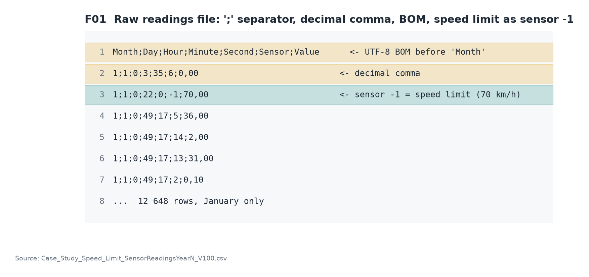
*F01 – Raw reading format incl. speed limit pseudo-sensor −1 (SPEC-05, REQ7).*

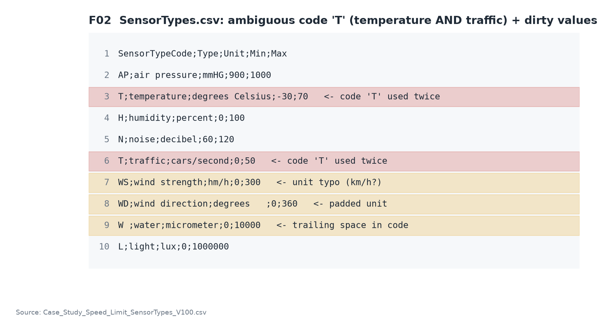
*F02 – Ambiguous sensor type code `T` (defect 16, D2).*

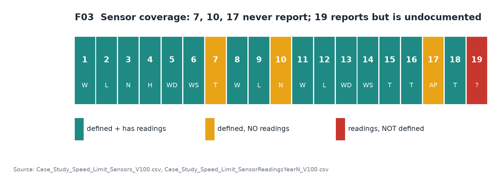
*F03 – Sensors without readings (7, 10, 17) and undocumented sensor 19 (D3).*

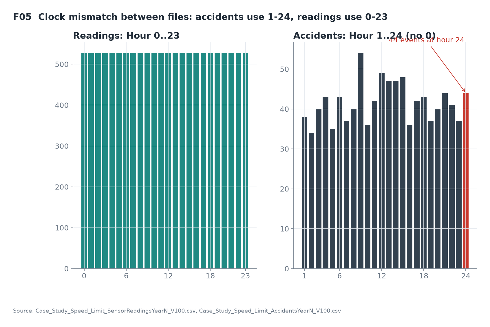
*F05 – Accident hours 1–24 vs reading hours 0–23 (D1).*

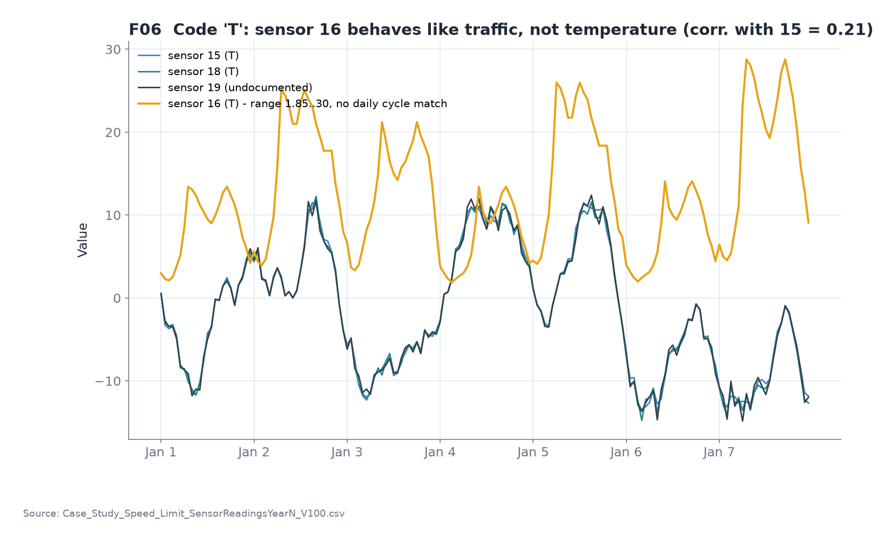
*F06 – Sensor 16 is traffic, not temperature (D2).*

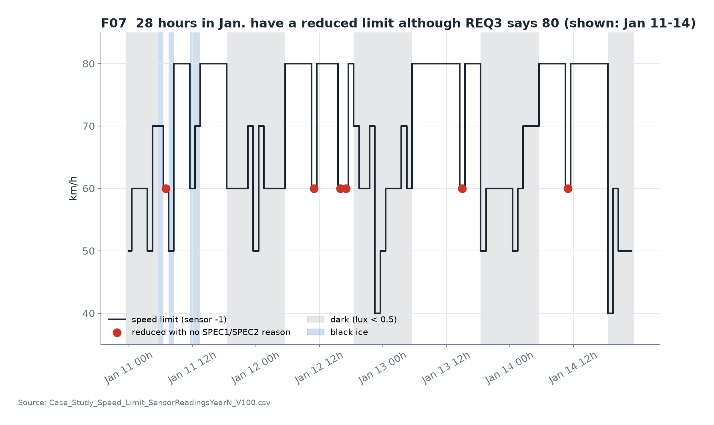
*F07 – 28 normal-condition hours with limit < 80 km/h (REQ3, D10).*

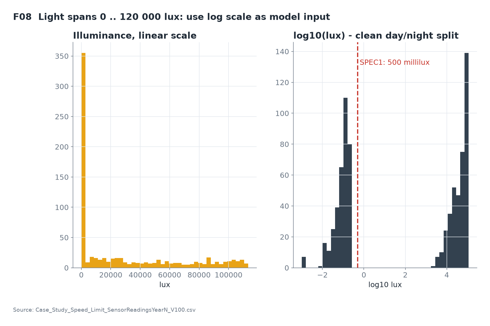
*F08 – log10(lux) as feature (SPEC-07).*

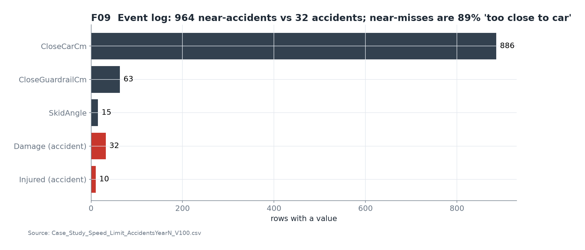
*F09 – 964 near-accidents (886 CloseCar, 63 CloseGuardrail, 15 SkidAngle) vs 32 accidents (SPEC4, D6).*

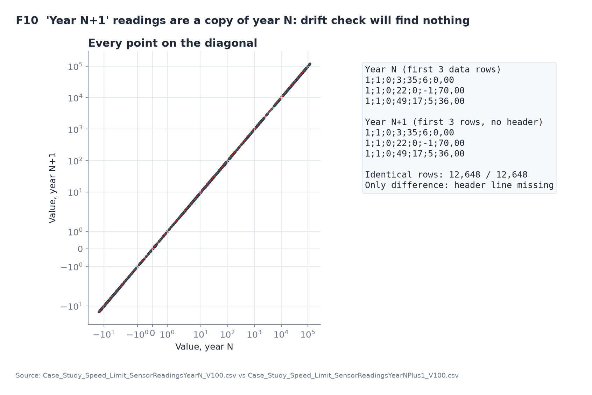
*F10 – Year N+1 is identical to year N (12 648 of 12 648 rows) (REQ9, D13).*

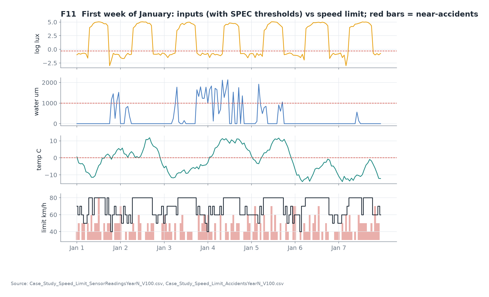
*F11 – One week of conditions and limits (SPEC1, SPEC2).*

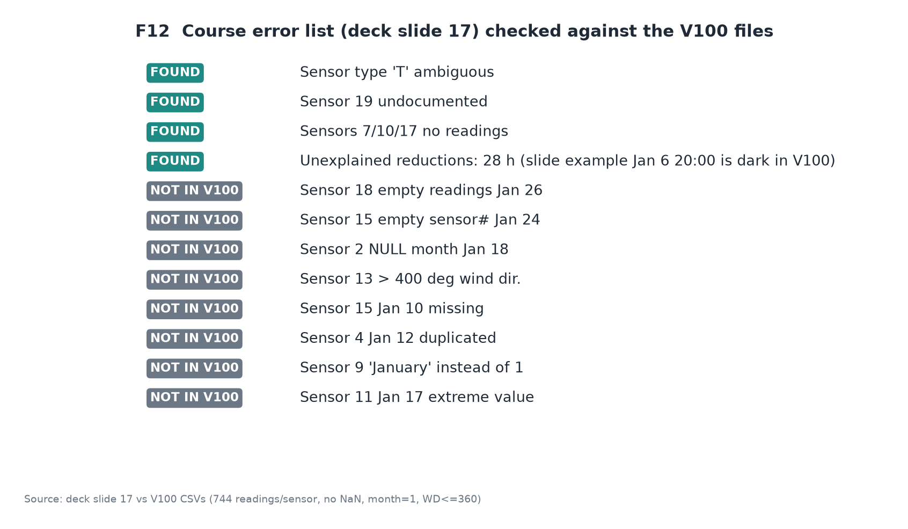
*F12 – Check of the slide-17 error list against V100 (SPEC-15, D19).*

---

## 11. Known conflict: REQ1 vs. the data (F04)

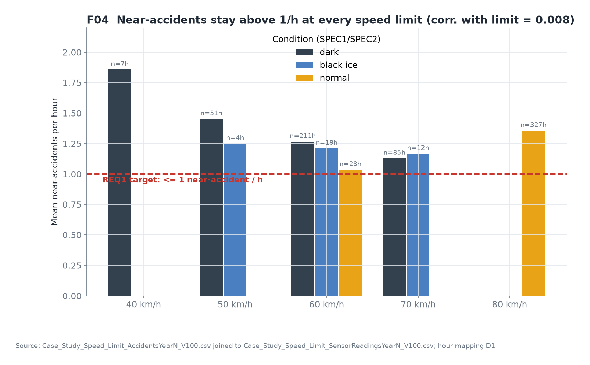
*F04 – Mean near-accidents per hour by condition and speed limit, year N.*

### 11.1 Finding

| Condition | Limit (km/h) | Hours | Mean near-accidents / h |
|---|---|---|---|
| Dark | 40 | 7 | 1.86 |
| Dark | 50 | 51 | 1.45 |
| Dark | 60 | 211 | 1.27 |
| Dark | 70 | 85 | 1.13 |
| Black ice | 50 | 4 | 1.25 |
| Black ice | 60 | 19 | 1.21 |
| Black ice | 70 | 12 | 1.17 |
| Normal | 60 | 28 | 1.04 |
| Normal | 80 | 327 | 1.35 |

- Overall rate: 1.3 near-accidents/h; correlation near-accidents vs. speed limit: 0.008; vs. traffic (sensor 16): 0.011.
- No observed combination reaches ≤ 1.0 / h; the lowest is 1.04 / h.
- Within dark and black-ice hours, *lower* limits coincide with *more* near-accidents. This is most likely confounding: operators lowered the limit when conditions were worse, a factor the features do not fully capture (D8).
- Small cells (dark 40 km/h: 7 hours; black ice 50 km/h: 4 hours) make these means unreliable.

### 11.2 Consequences for REQ1

| Aspect | Consequence |
|---|---|
| Feasibility | REQ1's target of ≤ 1 per hour cannot be shown to be achievable by changing the limit with this data. |
| Verifiability | The REQ1 *outcome* cannot be verified offline; only the *decision logic* (SPEC-09) can be tested. Verifying the outcome needs field data after deployment. |
| Model behaviour | An unguarded NN would learn "lower limit → more near-accidents" and recommend driving faster. |

### 11.3 How we handle it

| Measure | Requirement / decision |
|---|---|
| Build REQ1 as specified; do not silently change the target | D8, A-13 |
| Monotonicity guard so lower limits never look riskier | D9, NFR-03 |
| Target-not-reachable flag, shown to the operator, with predicted rate | D7, REQ1, NFR-05 |
| Report real test error vs. baseline; show F04 as key finding in the deck | REQ11, NFR-17 |
| Keep the 28 unexplained reductions in training but never output them | D10, REQ3 |
| Recommend to management: collect data with controlled limit changes (or more months, other seasons) before trusting the outcome of REQ1; reconsider the 1.0/h target with the operator | Open item for presentation |

### 11.4 Other requirement/data tensions

| Tension | Handling |
|---|---|
| Only January data (slide 17): black ice and darkness patterns are winter-only; the model is not valid for other seasons. | Scope limitation stated; drift check (REQ9) before use on other periods. |
| No air-quality history: REQ2 cannot be learnt or validated against outcomes. | LLM + deterministic fallback; tested on contract only (D14, D15). |
| Year N+1 identical to year N: drift check cannot detect real change on this data. | Verdict "no retraining" reported as a finding; synthetic shift test (AC-REQ9-02). |
| Black ice not dark: only 35 hours, so REQ1 under black ice in daylight is weakly supported. | Reported with the model error per condition. |

---

## 12. Open items (no lecturer questions; resolved by assumption, to revisit after MVP)

| ID | Item | Current assumption |
|---|---|---|
| O-01 | Is 1.0 near-accident/h a realistic target given an observed minimum of 1.04? | A-13 |
| O-02 | Highway coordinates for the air-quality API | Configurable; placeholder location in config |
| O-03 | Legal minimum limit below 40 km/h? | Not used (A-10) |
| O-04 | Should the operator be able to override and should overrides be logged? | Override = operator sets sign manually outside the MVP; recommendation logged (A-22) |
