# 03 · Data Analysis Report

| | |
|---|---|
| Document | 03 · Data Analysis Report (SpeedLimit case study, SE4AI) |
| Version | 0.1 |
| Date | 2026-11-10 |
| Status | Draft |
| Owner | Data Engineering |
| Covers | Deck slides 16–19: class diagram, error analysis and handling, feature engineering, cleaning spec, retraining analysis |
| Binding decisions | `05-decision-log.md` (D1–D20), referenced as "per Dx" |
| Evidence | `docs/figures/F01–F12` and `docs/figures/facts.json`, made by `analysis/make_figures.py`. Every other number in this report was recomputed from the V100 CSVs with read-only scripts in `analysis/scratch/` |

---

## 1. Executive summary

- **The format is clean, the meaning is not.** All V100 files parse without a single missing value, duplicate or out-of-range reading (12,648 readings, 744 per sensor, January only). The real problems are semantic: the sensor code `T` means two things, sensor 19 is undocumented, sensors 7/10/17 never report, and the two files count hours differently (1–24 vs 0–23).
- **The data barely supports REQ1.** Near-accidents average 1.30 per hour and stay at or above 1.04/h for every observed speed limit. Their correlation with the limit is 0.008. Lower limits even go with *more* incidents (dark: 1.86/h at 40 km/h vs 1.13/h at 70 km/h), which points to confounding, not to a causal effect.
- **The event counts look like pure Poisson noise.** The hourly count has variance 1.29 against a mean of 1.30, so it is not over-dispersed. No weather feature correlates with it beyond |r| = 0.05. A model can learn the overall level, but not a reliable effect of the limit.
- **Year N+1 is a byte-for-byte copy of year N** (12,648/12,648 rows identical, only the header line is missing). The drift check (per D13) will report no drift, so there is no retraining.
- **What we do anyway:** we build the REQ1 model as specified (D7), report its real error and a "target not reachable" flag (D8), force predictions to be monotone in the limit (D9), and make the cleaning pipeline robust against the slide-17 error classes that are absent from V100 (D19).

---

## 2. Dataset inventory

All files use `;` as separator and CRLF line endings, and none ends with a trailing newline. Readings use a decimal comma (`70,00`). The accident values are all integers, so the comma never shows up there.

| File | Data rows | Columns | Grain | Encoding quirks |
|---|---|---|---|---|
| `…_SensorReadingsYearN_V100.csv` | 12,648 | Month; Day; Hour; Minute; Second; Sensor; Value | one reading per sensor per hour (17 sensor IDs incl. −1 × 744 h) | UTF-8 BOM, header row, decimal comma |
| `…_SensorReadingsYearNPlus1_V100.csv` | 12,648 | same 7, **no header row** | same | UTF-8 BOM in front of the first *data* value, decimal comma |
| `…_AccidentsYearN_V100.csv` | 997 | Month; Day; Hour; Second; LicencePlate; Damage; Injured; CloseCarCm; CloseGuardrailCm; SkidAngle | one row per event | UTF-8 BOM. **No Minute column** (Hour + Second only). Hour runs 1–24 |
| `…_Sensors_V100.csv` | 18 | SensorID; SensorTypeCode | one row per installed sensor (IDs 1–18) | UTF-8 BOM |
| `…_SensorTypes_V100.csv` | 9 | SensorTypeCode; Type; Unit; Min; Max | one row per type | **No BOM** (unlike the others). Code `T` appears twice, `W ` has a trailing space, unit `hm/h`, unit `degrees   ` is padded |

Coverage: Jan 1 00:00 to Jan 31 23:00 = **744 hours**. Every reporting sensor has exactly 744 readings with `Month = 1`.

---

## 3. Data model

The slides call the speed limit a "special sensor reading with sensorID = −1". We model it as a subtype of `SensorReading` with no `Sensor` row behind it. Accident rows are one table holding two kinds of event, which we tell apart by which columns are filled (per D6). `HourlyObservation` is the derived training grain (section 7).

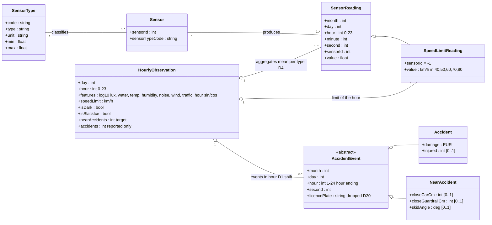

| Relationship | Cardinality in the model | Observed in V100 |
|---|---|---|
| SensorType → Sensor | 1 : 0..* | 8 distinct codes for 9 rows. `T` is ambiguous, so 4 sensors (7, 15, 16, 18) cannot be mapped to a unique type from metadata alone |
| Sensor → SensorReading | 1 : 0..* | 15 documented sensors × 744. Sensors 7/10/17 have 0. Sensor 19 has 744 but no Sensor row (orphan FK) |
| SpeedLimitReading per hour | exactly 1 | 744/744 hours |
| AccidentEvent per hour | 0..* | 0–5 near-accidents per hour, 997 rows in total |
| Accident vs NearAccident | disjoint | No row mixes the two groups. 1 row is empty (neither) |

---

## 4. Data quality findings

Severity: **High** = changes the model or labels if ignored. **Medium** = needs a rule but has limited impact. **Low** = cosmetic, or only a robustness concern.

| ID | Finding | Severity | Evidence | Handling rule |
|---|---|---|---|---|
| DQ-01 | UTF-8 BOM, `;` separator, decimal comma, CRLF, no final newline. SensorTypes has no BOM | Low | F01, byte check | Read with `sep=";"`, `encoding="utf-8-sig"` (also safe when there is no BOM), `decimal=","`. Assert the column count |
| DQ-02 | Sensor type code `T` defined twice (temperature −30..70 °C *and* traffic 0..50 cars/s) | High | F02, F06. Sensors 15/18/19 correlate ≥ 0.996, swing around 0 °C (−15.7..13.0). Sensor 16 runs 1.85..30 with r = 0.21 to sensor 15 | Per D2: 15/18/19 = temperature, 16 = traffic. Hard-code the mapping in the sensor registry, never derive it from the code |
| DQ-03 | Code `W ` (trailing space) in SensorTypes, while Sensors.csv uses `W` | Medium | F02 | Strip whitespace from every string key before joining |
| DQ-04 | Unit `hm/h` for wind strength (typo for km/h?) | Low | F02 | Document it as km/h (assumption). Unit doesn't affect the model because features are scaled |
| DQ-05 | Unit `degrees   ` padded with spaces | Low | F02 | Strip |
| DQ-06 | Sensor 19 has 744 readings but no Sensor row | Medium | F03. r ≥ 0.996 with 15/18 | Per D3: treat it as temperature. The registry lists it explicitly, and unknown IDs are logged and dropped (section 8) |
| DQ-07 | Sensors 7 (T), 10 (N) and 17 (AP) are defined but never report | Medium | F03. 0 rows each | Per D3: ignore. There is no air-pressure input. Noise comes from sensor 3 only |
| DQ-08 | Hour convention mismatch: readings 0–23, accidents 1–24 (no hour 0, 44 events at hour 24) | High | F05 | Per D1: accident hour h maps to reading hour h − 1. Sensitivity: without the shift, corr(near, limit) moves from 0.008 to 0.030, so either way there is no signal |
| DQ-09 | Accidents file has no Minute column (Hour + Second only) | Low | header | Events are only joined at hour grain. The second is discarded |
| DQ-10 | 28 hours with "normal" conditions (not dark, no ice) but a limit < 80 km/h, all at **60 km/h** | Medium | F07. They fall at 06–18h (peak 6 at 16h) in full daylight (hourly lux 9,611–107,827). Water ≤ 929 µm, so not even near SPEC2 | Per D10: keep them in training, flag `unexplained_reduction`, never output them (REQ3 forces 80). Likely an undocumented reason (roadworks, events, air quality?) |
| DQ-11 | One accident row with no event field set (Jan 24, Hour 15) | Low | F09, `acc_fields_per_row["0"] = 1` | Per D6: drop it and log it |
| DQ-12 | 10 rows with two fields set, all **Damage + Injured** (accidents with injuries). No mixed accident/near-accident row | Low | F09 | Not an error: Injured only ever appears with Damage. Each row is one accident. 32 accidents = 22 damage-only + 10 with injuries |
| DQ-13 | Near-accident rows carry no threshold: CloseCar 1–20 cm, Guardrail 5–20 cm, Skid 30–55°. The log is pre-filtered | Medium | F09, `closecar_max_cm = 20` | Per D6: every logged event counts. SPEC4 "too close" is taken as already applied by the logger (assumption) |
| DQ-14 | Year N+1 readings are identical to year N | High (for slide 19) | F10. 12,648/12,648 rows equal. Only difference: no header | Per D13: run the drift check, which reports no drift, so no retraining. Loader accepts the file with or without a header |
| DQ-15 | Timestamps differ per sensor within an hour. 13 sensors (1, 2, 4, 5, 8, 9, 11–15, 18, 19) share one batch timestamp. Speed limit (−1), noise (3), wind strength 6 and traffic (16) each have their own minute:second | Low | 5 distinct timestamps per hour in 741 h, 4 in 3 h. Speed-limit minute spread 0–59 | Aggregate on (Day, Hour) and ignore minute/second (D11). Assumption: the limit reading is the state valid for that hour |
| DQ-16 | Wind direction is reported while wind strength is 0. In 197 calm hours (mean WS = 0) the mean WD is > 0 in 142 of them (up to 146°) | Medium | slide-17 question | Encode wind as a vector: `wd_sin·ws`, `wd_cos·ws` would vanish when calm. Per D11 we keep sin/cos of WD **and** WS as a separate input, and set sin = cos = 0 when WS = 0 (section 7) |
| DQ-17 | 0° and 360° denote the same direction. V100 has 523 zero readings (sensors 5 + 13) and no 360. Max WD = 257 | Low | `wd_max = 257` | sin/cos encoding (D11) makes 0 and 360 identical. Values > 360 are out of range (section 8) |
| DQ-18 | Wind sensors agree less than the others: corr(5, 13) = 0.985, corr(6, 14) = 0.955, spread up to 51 km/h. In 218 hours one WS sensor reads 0 and the other doesn't | Low | scratch check | Per D4: use the mean and keep the spread as a quality signal |
| DQ-19 | `LicencePlate` is personal data (997 unique plates) | High (legal) | accidents header | Per D20: drop at load and never persist |
| DQ-20 | Only January: one month, winter only. Month is constant 1 | High | `Month = 1` everywhere | Seasonality can't be learned. Month is dropped (D11). The model is valid for winter conditions only (risk R1) |
| DQ-21 | Slide-17 errors are mostly **not in V100**: empty sensor 18 values, empty sensor# 15, NULL month, WD > 400, missing day for 15, duplicate day for 4, "January" text, extreme sensor-11 value | Info | F12. 744 readings/sensor, no NaN, month = 1, WD ≤ 360, no duplicates | Per D19: implement every repair anyway, unit-tested on injected faults (section 8) |
| DQ-22 | Slide-17 "Speed limit 6.1. 20:00 for no understandable reason" doesn't hold in V100: that hour is dark (lux 0.08), so 60 km/h is explained | Info | scratch check | Our own rule (DQ-10) replaces the slide's single example |
| DQ-23 | Redundant sensors (water ×3, light ×3, temp ×3, wind ×2) | Low | corr ≥ 0.995 for water/light/temp | Per D4: mean per type. In 5 hours the water sensors disagree on > 1000 µm, but the mean-based ice flag never flips |
| DQ-24 | The speed limit changes almost every hour: 329 changes in 744 h, median run 1 h | Medium | F07, F11 | No action. Read it as evidence that the logged limit is not a smooth operator policy, which weakens any causal reading |

---

## 5. Exploratory analysis

### 5.1 Raw format and metadata

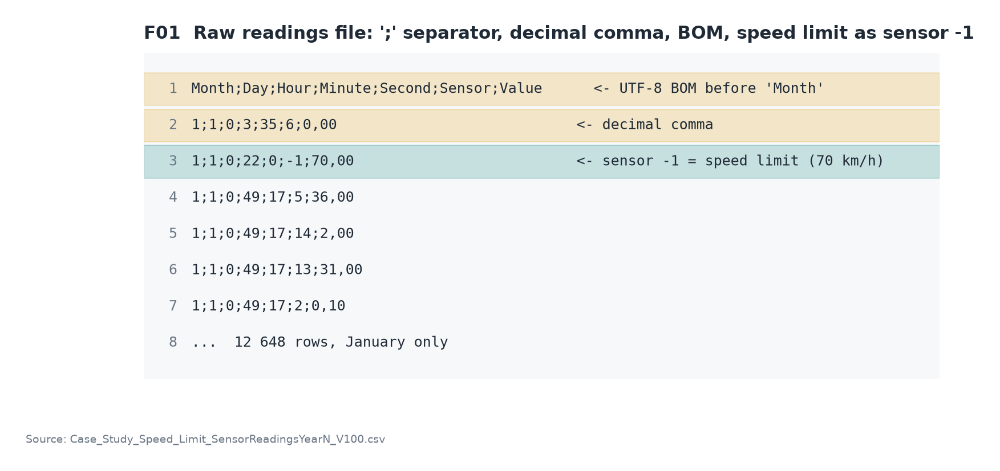

**F01 · Raw readings format.** The first lines of the readings file show the three things a naive `read_csv` gets wrong: the BOM glued to `Month`, the decimal comma, and the speed limit hidden as sensor −1. The parse is the first quality gate. Once these are handled, V100 needs no row-level repair at all.

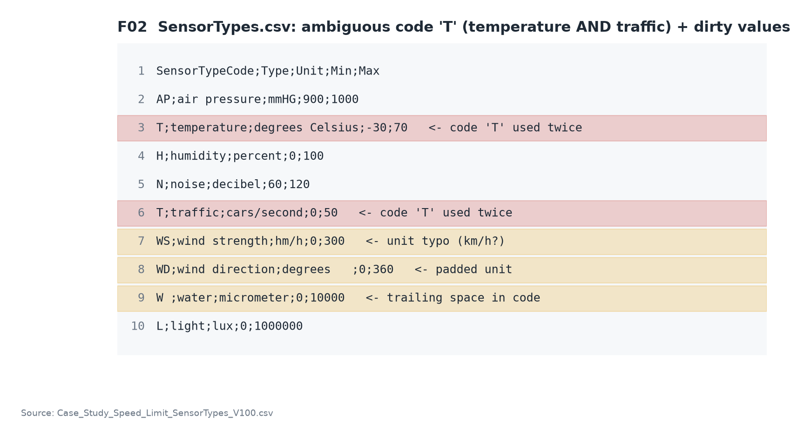

**F02 · SensorTypes metadata.** The type table is the dirtiest file even though it has only 9 rows: `T` is defined twice, `W ` carries a trailing space, and two units are malformed. Metadata can't be trusted as a join key, so we keep an explicit sensor registry in code (DQ-02..05).

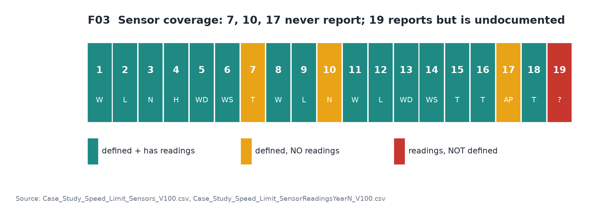

**F03 · Sensor coverage.** Sensors 7, 10 and 17 are installed on paper but never report. Sensor 19 reports all 744 hours with no description. The model therefore has no air-pressure input and a single noise sensor, and the loader must handle orphan IDs (D3).

### 5.2 Joining the two clocks

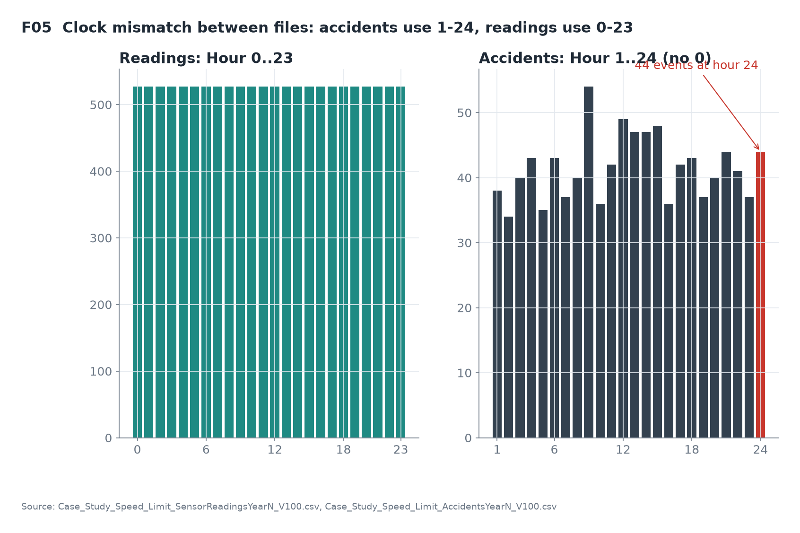

**F05 · Hour mismatch.** Readings use hours 0–23, accidents 1–24, with 44 events at "24" and none at 0. If we joined without a rule, a whole hour bucket of events would land on the wrong day or vanish. D1 maps accident hour h to reading hour h − 1. The REQ1 conclusion holds under either mapping.

### 5.3 Resolving the sensor semantics

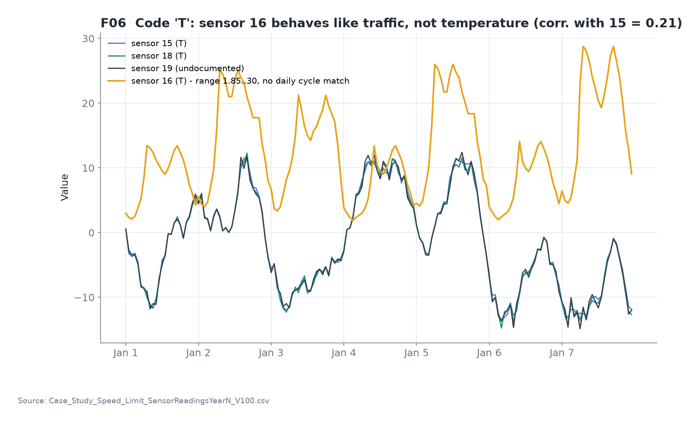

**F06 · Sensor 16 is traffic.** Sensors 15, 18 and 19 move together around 0 °C with a day–night cycle, while sensor 16 ranges 1.85–30 without following them (r = 0.21). That settles the ambiguous `T` (D2). Traffic becomes an input. It is not a target, which answers the slide-17 question about it.

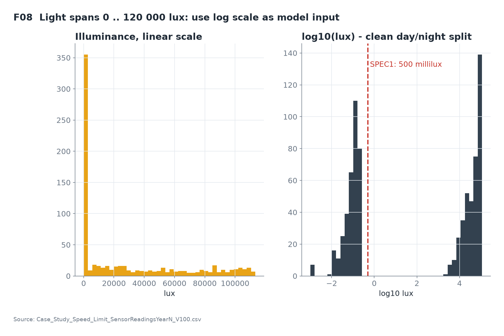

**F08 · Light needs a log scale.** Illuminance spans 0 to about 113,000 lux (hourly mean of 3 sensors), so on a linear axis all of night collapses into one bar. On log10 the distribution splits cleanly into night and day around the SPEC1 threshold of 0.5 lux. We feed `log10(lux + 0.001)` to the model (range −3.0 to 5.05) and compute `is_dark` with plain code (D5, D11).

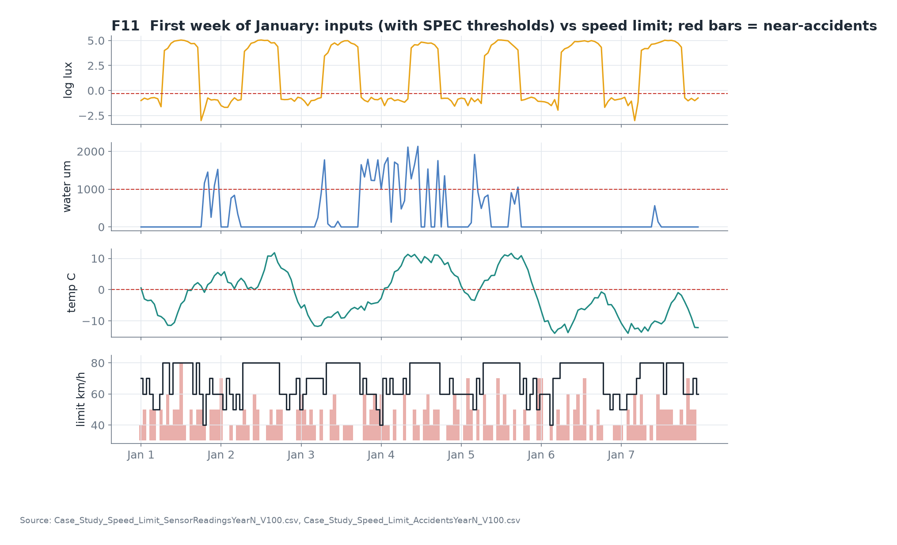

**F11 · One week of inputs vs limit.** Light, water and temperature behave plausibly against their SPEC thresholds, and black ice only occurs when wet and freezing coincide (62 h in the month, 27 of them also dark). The speed limit (bottom) jumps hour by hour, while near-accidents (red bars) look the same whatever the limit. That is the REQ1 problem in one picture.

### 5.4 Labels and target

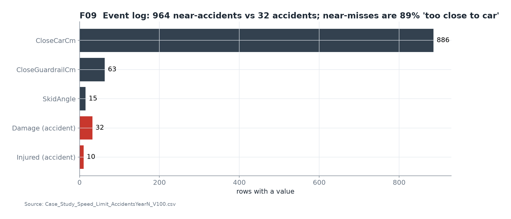

**F09 · Event composition.** Of 997 rows, 964 are near-accidents (89 % "too close to another car") and 32 are accidents, and 1 row is empty. Accidents are too rare (0.04/h) to learn from, so the target is near-accidents only (D6), and accidents are reported alongside.

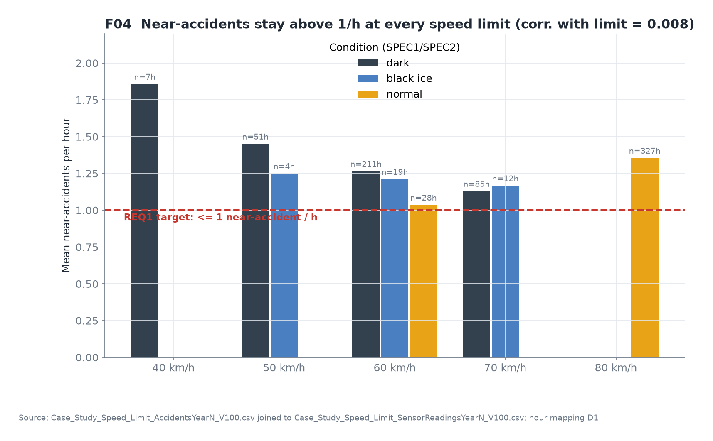

**F04 · The key finding for REQ1.** At every limit and condition the mean rate is above the 1/h target, and the overall correlation with the limit is 0.008. In the dark, the lower the limit the *higher* the rate (40 km/h: 1.86/h from only 7 hours), which is the signature of operators reacting to danger rather than of speed causing it. Section 6 has the detail.

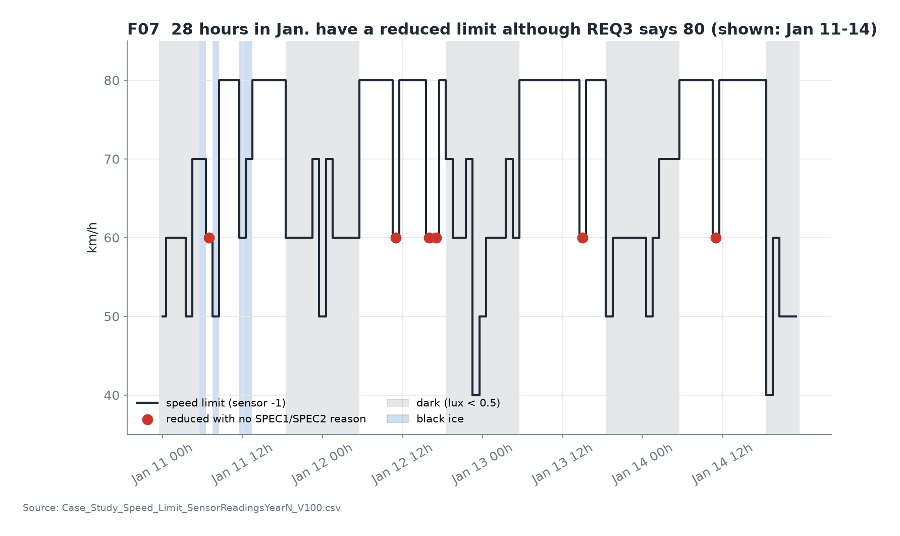

**F07 · Unexplained reductions.** Red dots mark 28 hours in which the limit was 60 km/h in daylight with a dry or above-zero road. Neither SPEC1 nor SPEC2 explains them, and REQ3 would demand 80. We keep them in training as real observations but never reproduce them (D10).

### 5.5 Version and course checks

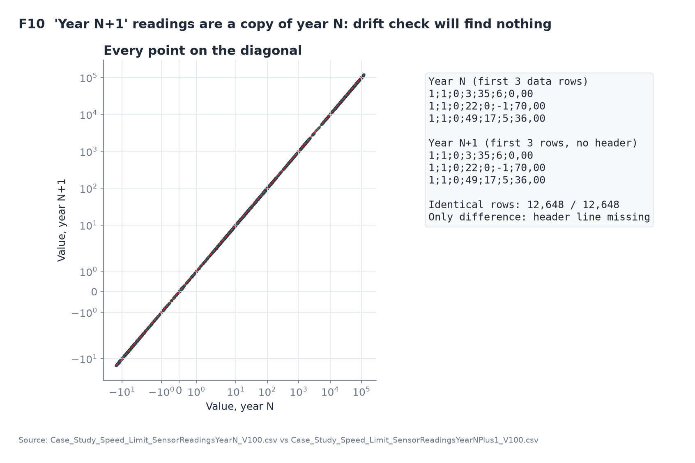

**F10 · Year N+1 = year N.** Every value pair lies on the diagonal, and the only difference is the missing header. Any drift statistic is exactly zero. That answers slide 19 for this dataset, but the drift tool stays in the pipeline for real data (section 9).

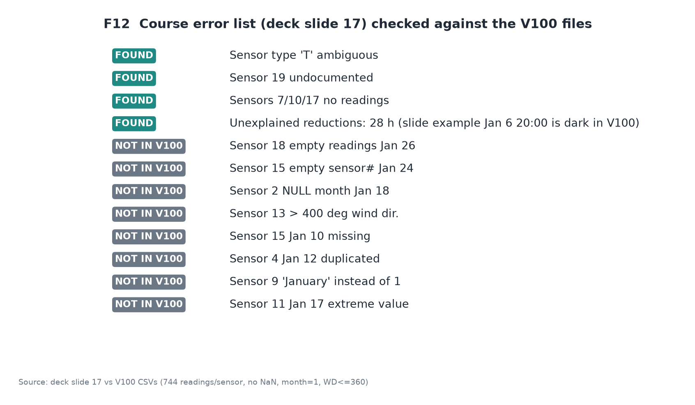

**F12 · Slide-17 claims vs V100.** Four of the twelve listed errors are present (the semantic ones), and eight row-level errors are absent from the V100 files. We handle the absent ones anyway, so the pipeline is safe on other data versions (D19).

---

## 6. REQ1 deep-dive: why the data barely supports it

REQ1: "When it is dark or there is danger of black ice, the speed limit shall be reduced so that there will be on average at most one near-accident per hour."

### 6.1 Rate per condition × limit

Condition is exclusive: dark wins over black ice (as in F04). n = hours. The 95 % interval uses the Poisson standard error √(mean/n).

| Condition | Limit | Hours (n) | Near-accidents | Mean / h | 95 % CI | Meets ≤ 1.0? |
|---|---|---|---|---|---|---|
| dark | 40 | 7 | 13 | 1.86 | 0.85–2.87 | no |
| dark | 50 | 51 | 74 | 1.45 | 1.12–1.78 | no |
| dark | 60 | 211 | 267 | 1.27 | 1.11–1.42 | no |
| dark | 70 | 85 | 96 | 1.13 | 0.90–1.36 | not provable |
| black ice | 50 | 4 | 5 | 1.25 | 0.15–2.35 | not provable |
| black ice | 60 | 19 | 23 | 1.21 | 0.72–1.71 | not provable |
| black ice | 70 | 12 | 14 | 1.17 | 0.56–1.78 | not provable |
| normal | 60 | 28 | 29 | 1.04 | 0.66–1.41 | not provable |
| normal | 80 | 327 | 443 | 1.35 | 1.23–1.48 | no |
| **all** | | **744** | **964** | **1.30** | | |

By condition: dark 1.27/h (354 h), black ice 1.20/h (35 h), normal 1.33/h (355 h). By limit: 40 → 1.86, 50 → 1.44, 60 → 1.24, 70 → 1.13, 80 → 1.36. No reduction-needing hour ever ran at 80 km/h, so the model has **no observation of "dark/ice at 80"** to compare against.

Accidents (not the target) are 5 in 35 black-ice hours (0.14/h), 9 in 354 dark hours (0.03/h) and 18 in 355 normal hours (0.05/h).

### 6.2 Confounding

- The limit is not set at random. It is lowered *because* conditions are worse, so hours at 40–50 km/h are the worst hours. A naive model reads "lower limit → more near-accidents" (within dark hours corr(near, limit) = −0.11) and would recommend driving faster.
- Condition and limit are almost collinear: dark/ice hours only ever have 40–70 km/h, and normal hours have 80 (plus 28 at 60). The data contains no counterfactual, i.e. no "same weather, different limit" with enough hours to compare.
- Mitigation: D9 forces predictions to be non-increasing as the limit drops (running minimum over descending limits). This removes the absurd direction, but it can't create a real effect that isn't in the data.

### 6.3 Small n where it matters

- 40 km/h: **7 hours** in total, all dark, all in days 1–24. The day split (D12) leaves 0 hours at 40 km/h and 0 black-ice hours at 50 or 70 km/h in the test set (days 25–31). These cells can't be validated at all.
- To pin a cell's rate to ±0.1/h (95 %) at λ ≈ 1.3 you need about 1.96² × 1.3 / 0.1² ≈ **500 hours per cell**. Only "dark 60" (211 h) and "normal 80" (327 h) come close.

### 6.4 Poisson-noise view

| Quantity | Value |
|---|---|
| Mean near-accidents / h | 1.296 |
| Variance of hourly count | 1.293, dispersion ≈ 1.00: textbook Poisson, no extra structure |
| Lag-1 autocorrelation of the hourly count | −0.02 |
| Hourly count distribution (0/1/2/3/4/5) | 206 / 263 / 163 / 80 / 25 / 7 hours |
| P(X ≤ 1) for Poisson λ = 1.3 | e^−1.3 × (1 + 1.3) = **0.627** (observed share of hours with ≤ 1: 0.630) |
| P(X ≥ 2) for λ = 1.3 | 0.373 |
| P(X ≥ 2) even at exactly λ = 1.0 (target met) | 0.264 |
| Max \|corr\| of near-accidents with any input (limit, lux, water, temp, humidity, noise, wind, traffic) | 0.043 (wind strength sensor 14). Speed limit 0.008, traffic 0.011 |
| MAE of constant-mean predictor | 0.927 |
| MAE of condition × limit mean (D12 baseline, in-sample) | 0.919 |

What this means:

- REQ1 is a statement about the **mean**. Even a perfect policy that achieves exactly 1.0/h will see two or more near-accidents in about one hour out of four. Single-hour outcomes can't verify or falsify the model. Only averages over hundreds of hours can.
- The counts behave as if drawn independently of the features. The best any model can do is close to the constant 1.3/h, and the cell baseline beats the constant by less than 0.01 in MAE.

### 6.5 What the model can and cannot learn

| Can learn | Cannot learn |
|---|---|
| The overall level of ~1.3 near-accidents/h | A causal effect of the limit on near-accidents |
| Rough cell means for well-populated cells (dark 60, normal 80) | Anything about dark/ice at 80 km/h (never observed) |
| That no observed limit reliably reaches ≤ 1.0/h | A trustworthy rate at 40 km/h (7 h) or for black ice at 50 km/h (4 h) |
| Deterministic conditions (dark, ice), which it doesn't need to: they are code (D5) | Seasonal effects (January only) |

### 6.6 What we do anyway

1. Train the count regression `near_accidents_per_hour = f(features, speed_limit)` exactly as SPEC3 asks (D7). At runtime, evaluate {40, 50, 60, 70, 80} and choose the highest limit predicted ≤ 1.0. Otherwise choose the highest limit within ε = 0.05/h of the lowest prediction (D25) and raise **"target not reachable"**.
2. Apply the monotonicity guard (D9) so the confounded data can't recommend a higher limit for worse conditions.
3. Report the real test error against both the constant and the cell baseline (D12). Expect the network to be roughly on par with them, and state that openly (D8).
4. Present F04 as a key finding, and recommend collecting data with deliberate limit variation (A/B hours) before the system is used for real decisions.

---

## 7. Feature engineering specification

### 7.1 Inputs and target (one row = one hour)

All sensor values are hourly means over the redundant sensors (D4). Ranges are observed V100 hourly values.

| # | Feature | Source sensors | Transform | Unit | Observed range |
|---|---|---|---|---|---|
| 1 | `log_lux` | 2, 9, 12 | log10(mean + 0.001) | log10 lux | −3.00 … 5.05 |
| 2 | `water_um` | 1, 8, 11 | mean | µm | 0 … 2,239 |
| 3 | `temp_c` | 15, 18, 19 (D2/D3) | mean | °C | −14.7 … 12.1 |
| 4 | `humidity_pct` | 4 | as is | % | 71.0 … 100 |
| 5 | `noise_db` | 3 (10 silent) | as is | dB | 80.7 … 111.4 |
| 6 | `wind_strength` | 6, 14 | mean | km/h (assumed, DQ-04) | 0 … 125.5 |
| 7–8 | `wind_dir_sin`, `wind_dir_cos` | 5, 13 | mean angle, then sin/cos. Set to 0/0 when wind strength = 0 | – | −1 … 1 (raw WD 0 … 251.5°) |
| 9 | `traffic_cps` | 16 (D2) | as is | cars/s | 1.85 … 30 |
| 10–11 | `hour_sin`, `hour_cos` | reading Hour | 2π·h/24 | – | −1 … 1 |
| 12 | `speed_limit` | −1 | as is (decision variable, varied at runtime) | km/h | {40, 50, 60, 70, 80} |
| T | **`near_accidents`** (target) | accidents with CloseCar/Guardrail/Skid | count per (Day, Hour − 1) (D1, D6) | events/h | 0 … 5 (mean 1.30) |

Derived but **not** model inputs (they run as rules, D5): `is_dark = mean lux < 0.5` (354 h), `is_black_ice = mean water > 1000 and mean temp < 0` (62 h), `needs_reduction = is_dark or is_black_ice` (389 h), `unexplained_reduction` (28 h, D10), `accidents` count (32), and per-type sensor spread (quality monitoring, D4).

Dropped (D11, D20): Month (constant), Day (would leak the split), Minute/Second (DQ-15), LicencePlate, Damage/Injured (they are outcomes; slide 17's "total danger index" is rejected because 32 accidents can't carry a weighting). Sensors 7/10/17 have no data. Inputs are standardised (z-score, fitted on training days only) before the MLP (D18).

On wind: the slide-17 question whether wind direction means anything at wind speed 0 is answered by zeroing the direction encoding in calm hours. A calm hour then looks the same whatever stale direction the vane reports.

### 7.2 From raw CSV to the hourly training table

1. **Load** each file with `sep=";"`, `utf-8-sig`, `decimal=","`. Detect a missing header (N+1) by checking whether the first cell is numeric.
2. **Drop PII** (`LicencePlate`) right after load (D20).
3. **Normalise metadata:** strip all string keys and apply the hard-coded sensor registry (15/18/19 → temp, 16 → traffic, 19 added, 7/10/17 marked silent).
4. **Validate and repair rows** following the cleaning rules (section 8). Log every repair with its rule ID.
5. **Pivot readings** to one row per (Day, Hour) with one column per sensor. Use mean if duplicates survive, and ignore minute and second.
6. **Aggregate per type** (D4): the means above plus spread columns.
7. **Derive conditions** (D5) and the `unexplained_reduction` flag (D10).
8. **Build the target:** drop the empty accident row, shift accident hours by −1 (D1), count near-accidents and accidents per (Day, Hour), and left-join with fill 0.
9. **Feature transforms** (7.1): log lux, sin/cos, calm-wind zeroing.
10. **Assert the contract:** 744 rows per 31-day month, no NaN in inputs, ranges within the registry, target ≥ 0. Write `hourly.parquet` plus a data-quality log.
11. **Split by day** (D12: days 1–24 train = 576 h, 25–31 test = 168 h). Fit the scaler on train only.

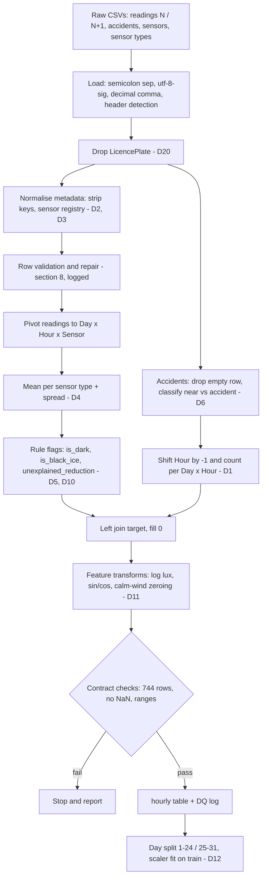

---

## 8. Cleaning specification

Each rule has an ID, a detection, an action, and whether it triggers on V100. Rules marked **slide 17 / not in V100** are implemented and unit-tested with injected faults (D19). "Reject" means the row is removed and logged. "Impute" values get a boolean `_imputed` flag carried to the hourly table.

| Rule | Error class | Detection | Action | Fires on V100? |
|---|---|---|---|---|
| C01 | Encoding / format | BOM, `;`, decimal comma, missing header | Robust loader (step 1). Fail loudly on a wrong column count | yes (handled at parse) |
| C02 | String keys with whitespace | `str != str.strip()` | Strip | yes (`W `, `degrees   `) |
| C03 | Ambiguous / unknown type code | duplicate code in SensorTypes | Registry overrides the metadata (D2) | yes (`T`) |
| C04 | Reading for an undocumented sensor | Sensor ∉ registry | Mapped sensors (19) are kept. Others are rejected and logged | yes (19 kept) |
| C05 | Documented sensor without readings | registry sensor with 0 rows | Mark silent. Model must not expect it | yes (7, 10, 17) |
| C06 | Missing / empty sensor ID (slide 17: sensor 15, Jan 24) | Sensor is NaN | If exactly one expected sensor is missing in that (Day, Hour) batch timestamp, assign it. Otherwise reject | no |
| C07 | Missing / empty value (slide 17: sensor 18, Jan 26) | Value is NaN | Fill from the sibling sensors of the same type (D4 mean of the rest). If there are no siblings, linear interpolation over ≤ 3 h. Otherwise mark the hour incomplete and exclude it from training | no |
| C08 | Month as NULL or text (slide 17: sensor 2 NULL, sensor 9 "January") | Month not an int in 1..12 | Map month names to numbers. NULL becomes the file's modal month (V100: 1), flagged | no |
| C09 | Value out of sensor range (slide 17: WD > 400°) | Value outside the registry min/max (WD 0..360, water 0..10,000, temp −30..70, …) | Set to NaN, then apply C07. WD = 360 is normalised to 0 | no (max WD 257) |
| C10 | Extreme in-range spike (slide 17: sensor 11, Jan 17) | Deviates from the sibling median by > 5 × the sibling MAD, or is a > 6σ jump vs neighbours (single-sensor types) | Set to NaN, then apply C07 | no |
| C11 | Missing day / gap (slide 17: sensor 15 Jan 10) | Count per sensor per day < 24 | Siblings cover it (D4 mean over the available ones). If a whole type is missing, exclude those hours | no |
| C12 | Duplicate readings (slide 17: sensor 4 Jan 12) | Duplicate (Day, Hour, Sensor) | Identical duplicates: keep one. Conflicting ones: take the mean and flag | no |
| C13 | Hour convention | accidents Hour ∈ 1..24 | Shift −1 (D1). Assert the result is in 0..23 | yes |
| C14 | Empty accident row | none of the 5 event fields set | Reject (D6) | yes (1 row) |
| C15 | Mixed accident / near-accident row | Damage/Injured **and** a near field set | Count it in both groups, flagged | no |
| C16 | Speed limit not in {40..80 step 10} or missing for an hour | value check / count | Missing: carry forward ≤ 1 h, otherwise exclude the hour. Invalid: reject | no |
| C17 | Unexplained reduction | normal conditions and limit < 80 | Keep, flag (D10) | yes (28 h) |
| C18 | Wind direction while calm | WS = 0 | Zero the sin/cos encoding (7.1) | yes (197 h) |
| C19 | PII | LicencePlate column | Drop at load (D20) | yes |
| C20 | Constant / leakage columns | Month, Day, Minute, Second | Exclude from features (D11) | yes |
| C21 | Readings file identical to an earlier year | row hash equality | Warn "duplicate dataset" in the drift report (D13) | yes (N+1) |

Unit tests: one test per rule that fires on V100 (expected counts: C04 = 744 rows kept for sensor 19, C14 = 1, C17 = 28, C13 = 44 events moved from 24 to 23), plus one injected-fault test per slide-17 class (C06–C12, C15, C16).

---

## 9. Retraining analysis (year N+1)

**Method (D13).** The N+1 file goes through the same pipeline (section 7.2). Each model input is then compared between N and N+1:

| Check | Statistic | Alarm threshold (proposal) |
|---|---|---|
| Distribution shift per feature | Two-sample Kolmogorov–Smirnov D and p-value | p < 0.01 **and** D > 0.1 |
| Level shift | Mean difference in units of the year-N std | \|Δ\| > 0.25 σ |
| Condition mix | Share of dark / ice / normal hours | > 5 percentage points |
| Policy shift | Speed-limit distribution per condition (χ²) | p < 0.01 |
| Sensor health | Silent / new sensor IDs, per-type spread | any change |
| Label shift (only when N+1 accidents exist) | Near-accidents/h per condition × limit | outside the year-N 95 % CI |
| Duplicate guard | Row-level equality with the training file | any 100 % match → warn |

**Result.** 12,648 of 12,648 rows are identical (F10): same values, timestamps and sensors. Only the header row is missing. Every KS D is 0, every mean shift is 0 and every mix is the same. **Verdict: no drift, so no retraining.** We also report the finding itself: the "next year" file is a copy, so it carries no information and can't validate the model out of time. No accidents file for N+1 was provided, so label drift and real model performance in N+1 can't be measured.

**What to watch for with real N+1 data:**

- Months other than January (seasonal shift in lux, temperature, ice frequency). That would be covariate shift outside the training support, so retrain or restrict use to winter.
- Changes in operator policy (a different limit mix per condition) change the confounding structure. Retrain and re-check D9.
- Sensor replacements or recalibration show up as a level shift in one sensor but not its siblings (watch the spread).
- Traffic volume trends (sensor 16), since traffic plausibly drives near-accidents more than the limit does.
- When N+1 accidents arrive: compare the predicted and observed near-accident rate per condition. A sustained gap outside the CI is the strongest retraining trigger.
- Decision rule: retrain if any *input* alarm fires on ≥ 2 features or the label check fails. Otherwise keep the model and log the report.

---

## 10. Open data risks

| ID | Risk | Impact | Mitigation / owner |
|---|---|---|---|
| R1 | One month (January) of training data | Model invalid outside winter, no seasonality | Restrict use to winter conditions, request more data (Data Eng.) |
| R2 | Near-accidents independent of all features (Poisson noise, r ≤ 0.04) | Model ≈ constant, REQ1 decisions near-arbitrary | D8 transparency, show the predicted rate and flag in the GUI |
| R3 | Confounding of limit and conditions | Model may learn "slower = more dangerous" | D9 monotonicity guard. Propose controlled limit experiments |
| R4 | Sparse cells (40 km/h = 7 h, ice@50 = 4 h), absent from the test split | Unvalidated predictions exactly where reductions are largest | Report per-cell n and CI. Consider cross-validation by day folds as a supplement |
| R5 | Assumed semantics (D1 hour shift, D2 sensor 16 = traffic, sensor 19 = temp, `hm/h` = km/h) | Wrong joins or units if an assumption is false | Documented in the decision log. Sensitivity check shows D1 doesn't change the conclusion |
| R6 | Near-accident log is pre-filtered (CloseCar ≤ 20 cm), threshold unknown | Target definition may differ from SPEC4's intent | D6 assumption, validate with the operator later |
| R7 | 28 unexplained reductions hint at an unrecorded reason (roadworks, air quality?) | A hidden variable affects both limit and risk | Flag and keep (D10). Ask for an operator reason log |
| R8 | Year N+1 is a copy | No out-of-time validation possible | Report it. Drift tool ready for real data (D13) |
| R9 | V100 is clean, other versions may not be | Pipeline untested on real faults | D19 injected-fault tests for every slide-17 class |
| R10 | Accidents file has no Minute, readings have per-sensor timestamps | Sub-hour alignment impossible | Hour grain only (DQ-09, DQ-15) |
| R11 | Licence plates in raw data | GDPR exposure if the raw file is copied into artefacts | D20: drop at load, never commit derived files with plates |
