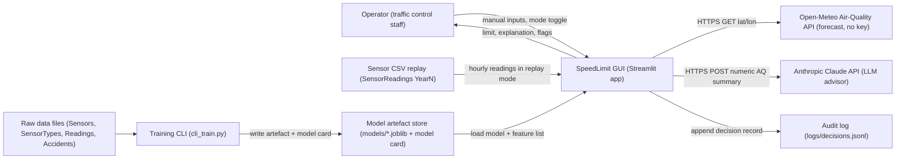
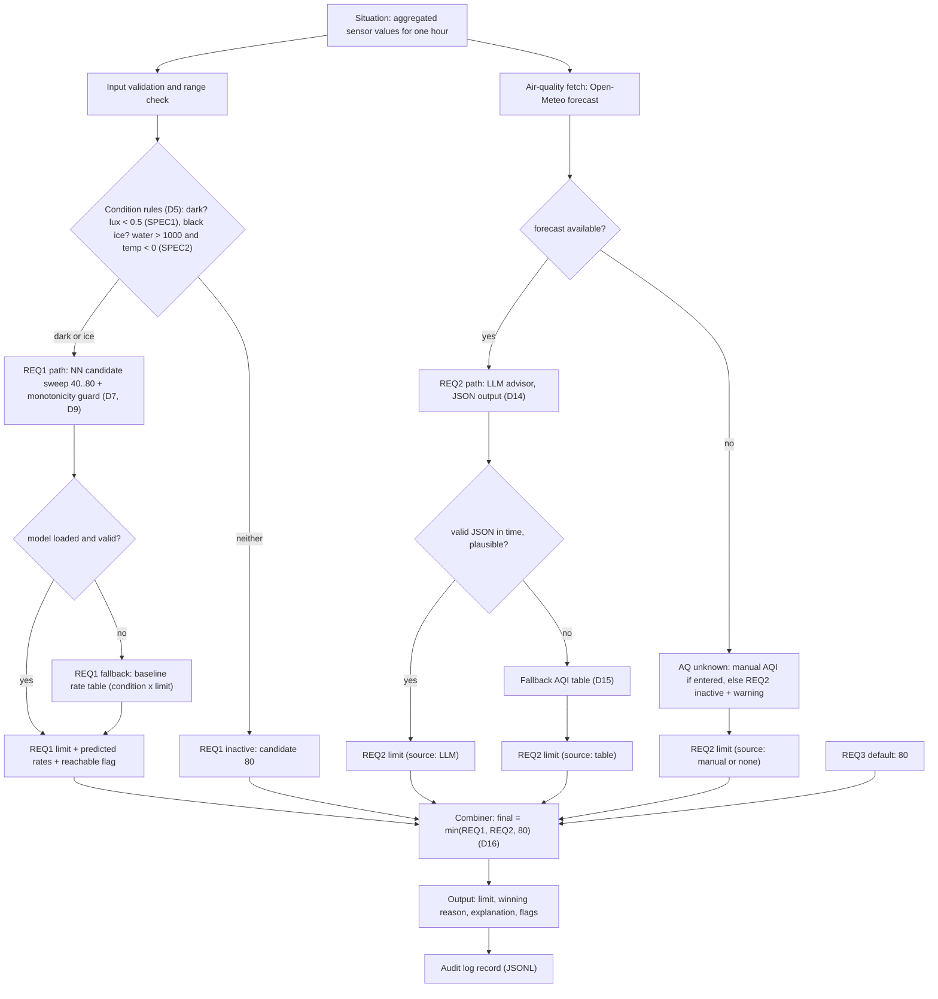
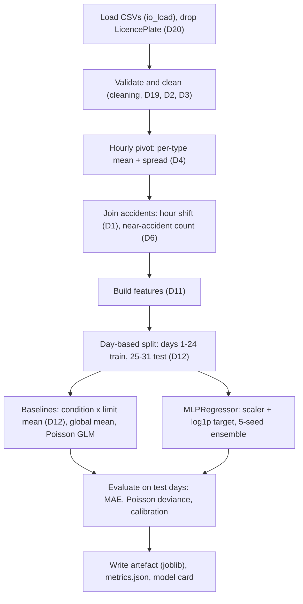
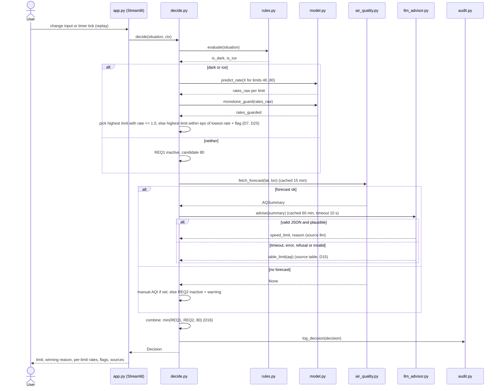
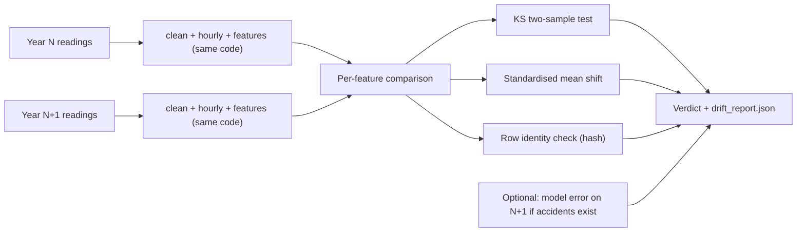

# 04 · Solution Architecture

| | |
|---|---|
| Document | 04 · Solution Architecture (SpeedLimit MVP) |
| Version | 0.1 |
| Date | 2026-11-10 |
| Status | Draft |
| Owner | Architecture & ML |
| Binding inputs | Case study slides 3, 9, 11, 15–19 · Main exercise slide 32 · Decision log D1–D20 (`05-decision-log.md`) · Figures F01–F12, `figures/facts.json` |

This document describes how the SpeedLimit MVP is built: the components, the router that decides which reason applies, the training pipeline for the neural network, the LLM path for air quality, the GUI, and the drift check. It is a design document. Code snippets are limited to signatures. Decisions from the decision log are referenced by ID (e.g. "per D7") and are not repeated in full.

---

## 1. Architecture goals and constraints

### 1.1 Goals

| ID | Goal | What it means for the design |
|---|---|---|
| G1 | **MVP** | One Python package, one Streamlit app, one training CLI. No server deployment, no database, no message bus (slide 32). Files on disk are the artefact store. |
| G2 | **Safety first** | Deterministic rules decide *whether* a reason applies (D5). Every learned or external component has a deterministic fallback (D15). The most restrictive reason wins (D16). Outputs are always in {40, 50, 60, 70, 80}. |
| G3 | **Explainable** | Every decision records which reason won, the per-limit predicted near-accident rates, the LLM reason text, and the source of each value (model / LLM / fallback table / default). |
| G4 | **Offline-capable** | With no network, the app still produces a limit: rules + NN run locally; REQ2 falls back to the AQI table (D15) and to a manual AQI input when no forecast is available (see 7.6). |
| G5 | **Honest about data** | The weak REQ1 signal (F04, D8) is visible in the GUI and in the model card, not hidden. |
| G6 | **Testable** | Pure functions for rules, features and decisions. External calls (Open-Meteo, Claude) sit behind small adapters that tests can replace. |

### 1.2 Constraints

| Constraint | Source |
|---|---|
| Neural network required for REQ1 (SPEC3) | Slides 3, 11 |
| NN only used when dark or black-ice danger | Slide 3, D5 |
| LLM decides REQ2 from air quality queried via API | Slide 3, D14 |
| 80 km/h when no reason applies | REQ3 |
| Stack: Python 3.13, pandas, scikit-learn `MLPRegressor`, Streamlit, anthropic SDK, requests, pytest | D18 |
| Training data: 744 hourly rows, January only | facts.json, slide 17 |
| No real sensors; GUI inputs instead | Slide 32, D17 |
| `LicencePlate` never loaded into memory beyond the reader | D20 |

---

## 2. Context diagram



| External element | Direction | Data | Failure behaviour |
|---|---|---|---|
| Operator | in/out | Sensor values, mode, AQI override; sees limit and explanation | — |
| Sensor CSV replay | in | One aggregated hour per tick (D17) | Missing file: replay mode disabled, manual mode still works |
| Open-Meteo | in | Hourly forecast: `european_aqi`, `pm2_5`, `pm10`, `nitrogen_dioxide`, `ozone` (D14) | Timeout / error: cached value ≤ 3 h old, else "AQ unknown" (7.6) |
| Claude API | in/out | Numeric AQ summary in, JSON `{speed_limit, reason}` out (D14) | Timeout / invalid / refusal: AQI table (D15) |
| Artefact store | in | `model.joblib` with feature list, scaler, version | Missing / version mismatch: REQ1 path uses baseline table (8.3), flagged |

---

## 3. Router architecture

The router is the core of the operational stage (slide 15 "Arc Diag with ROUTER"). It takes one *situation* (one hour of sensor values plus air-quality data) and sends it to the right decision path. The rules decide which paths are active. Each path produces a candidate limit. The combiner takes the minimum (D16).



### 3.1 Router rules in plain words

1. **Rules first.** `rules.evaluate(situation)` returns `is_dark` and `is_ice` using the D5 thresholds on the per-type means (D4). The NN is never asked whether it is dark or icy.
2. **REQ1 path** runs only if `is_dark or is_ice` (slide 3). It sweeps the five candidate limits through the model, applies the monotonicity guard (D9) and picks the limit per D7.
3. **REQ2 path** always runs. The LLM decides "if and by how much" (slide 3). An LLM answer of 80 means "no reduction".
4. **REQ3** is the constant 80, always present in the combiner.
5. **Combiner:** `final = min(req1_limit, req2_limit, 80)`. The winning reason is the path with the lowest limit; ties are reported as all tied reasons (e.g. "REQ1 + REQ2").
6. **Fallbacks** never block a decision. The app always shows a limit and states the source of each part.

---

## 4. Component catalogue

### 4.1 Package layout

```
speedlimit/                      (project root)
├── config.yaml
├── pyproject.toml
├── data/raw/                    (course CSVs, read-only)
├── data/processed/              (hourly table, parquet/csv)
├── models/                      (artefacts: model_<version>.joblib, model_card_<version>.md)
├── logs/                        (decisions.jsonl, llm_calls.jsonl)
├── reports/                     (metrics.json, drift_report.json, plots)
├── src/speedlimit/
│   ├── __init__.py
│   ├── config.py
│   ├── types.py
│   ├── io_load.py
│   ├── cleaning.py
│   ├── features.py
│   ├── rules.py
│   ├── model.py
│   ├── decide.py
│   ├── air_quality.py
│   ├── llm_advisor.py
│   ├── drift.py
│   ├── audit.py
│   ├── app.py
│   └── cli_train.py
└── tests/
    ├── conftest.py
    ├── fixtures/                (tiny CSVs with injected faults, D19)
    ├── unit/
    │   ├── test_io_load.py
    │   ├── test_cleaning.py
    │   ├── test_features.py
    │   ├── test_rules.py
    │   ├── test_model.py
    │   ├── test_decide.py
    │   ├── test_air_quality.py
    │   ├── test_llm_advisor.py
    │   └── test_drift.py
    └── integration/
        ├── test_training_pipeline.py
        └── test_router_end_to_end.py
```

`config.py`, `types.py` and `audit.py` are small helper modules added to the list in the brief; they keep the main modules free of config parsing and logging code.

### 4.2 Catalogue

| Component | Responsibility | Module | Key interface |
|---|---|---|---|
| Config | Load and validate `config.yaml`, env vars | `config.py` | `load_config(path: Path = Path("config.yaml")) -> Config` |
| Shared types | Dataclasses for situation, results, decision | `types.py` | `Situation`, `RuleResult`, `Req1Result`, `Req2Result`, `Decision` |
| Loader | Read the four CSVs, enforce dtypes, drop `LicencePlate` at read time (D20) | `io_load.py` | `load_readings(path: Path) -> pd.DataFrame` · `load_accidents(path: Path) -> pd.DataFrame` · `load_sensors(path: Path, types_path: Path) -> pd.DataFrame` |
| Cleaning | Slide-17 repairs (D19): text months, NULL months, missing sensor IDs, duplicates, out-of-range values, missing hours; sensor type fix (D2, D3) | `cleaning.py` | `clean_readings(df: pd.DataFrame, sensors: pd.DataFrame, cfg: CleaningConfig) -> tuple[pd.DataFrame, CleaningReport]` |
| Hourly pivot + join | Wide hourly table, per-type mean and spread (D4), speed limit per hour, accident hour shift (D1), near-accident count (D6) | `cleaning.py` | `to_hourly(df: pd.DataFrame) -> pd.DataFrame` · `join_accidents(hourly: pd.DataFrame, acc: pd.DataFrame) -> pd.DataFrame` |
| Features | D11 feature set; same function for training and runtime | `features.py` | `FEATURES: list[str]` · `build_features(hourly: pd.DataFrame) -> pd.DataFrame` · `situation_to_frame(s: Situation, limits: Sequence[int]) -> pd.DataFrame` |
| Rules | SPEC1 / SPEC2 thresholds (D5) | `rules.py` | `is_dark(lux_mean: float, cfg: RulesConfig) -> bool` · `is_black_ice(water_mean: float, temp_mean: float, cfg: RulesConfig) -> bool` · `evaluate(s: Situation, cfg: RulesConfig) -> RuleResult` |
| Model | Train, save, load, predict; baseline; monotonicity guard | `model.py` | `train(X: pd.DataFrame, y: pd.Series, cfg: ModelConfig) -> ModelArtefact` · `predict_rate(art: ModelArtefact, X: pd.DataFrame) -> np.ndarray` · `save(art: ModelArtefact, path: Path) -> None` · `load(path: Path) -> ModelArtefact` · `monotone_guard(rates: Mapping[int, float]) -> dict[int, float]` |
| Decision logic | REQ1 sweep and selection (D7), combiner (D16), explanation text | `decide.py` | `req1_limit(s: Situation, art: ModelArtefact \| None, cfg: DecideConfig) -> Req1Result` · `combine(rule: RuleResult, r1: Req1Result, r2: Req2Result) -> Decision` · `decide(s: Situation, ctx: RuntimeContext) -> Decision` |
| Air quality | Open-Meteo forecast fetch, cache, summary | `air_quality.py` | `fetch_forecast(lat: float, lon: float, cfg: AQConfig) -> AQForecast \| None` · `summarise(fc: AQForecast, horizon_h: int) -> AQSummary` · `table_limit(eu_aqi: float) -> int` |
| LLM advisor | Prompt build, Claude call, JSON validation, fallback (D14, D15) | `llm_advisor.py` | `advise(summary: AQSummary, cfg: LLMConfig, client: Anthropic \| None = None) -> Req2Result` · `build_prompt(summary: AQSummary) -> tuple[str, str]` · `validate(raw: str, summary: AQSummary) -> LLMAdvice` |
| Drift | Year N vs N+1 comparison (D13) | `drift.py` | `drift_report(ref: pd.DataFrame, new: pd.DataFrame, features: list[str], cfg: DriftConfig) -> DriftReport` · `verdict(report: DriftReport) -> Literal["retrain", "no_retrain"]` |
| Audit | Append-only JSONL decision log | `audit.py` | `log_decision(d: Decision, path: Path) -> None` · `read_log(path: Path, n: int = 50) -> pd.DataFrame` |
| GUI | Streamlit page: inputs, replay timer, results, explanation, chart, log (D17) | `app.py` | `main() -> None` (run with `streamlit run src/speedlimit/app.py`) |
| Training CLI | Run the full training pipeline and write artefact, metrics, model card | `cli_train.py` | `main(argv: list[str] \| None = None) -> int` (`python -m speedlimit.cli_train --config config.yaml`) |

### 4.3 Core data types (signature level)

```python
@dataclass(frozen=True)
class Situation:
    timestamp: datetime          # hour being decided
    lux: float                   # mean of sensors 2/9/12 (D4)
    water_um: float              # mean of 1/8/11
    temp_c: float                # mean of 15/18/19 (D2, D3)
    humidity: float
    noise_db: float
    wind_strength: float
    wind_dir_deg: float
    traffic_cps: float           # sensor 16 (D2)
    current_limit: int           # informational only, not a model input at runtime

@dataclass(frozen=True)
class Req1Result:
    active: bool
    limit: int
    rates_raw: dict[int, float]      # model output per candidate limit
    rates_guarded: dict[int, float]  # after D9
    target_reachable: bool
    source: Literal["model", "baseline_table", "inactive"]

@dataclass(frozen=True)
class Req2Result:
    limit: int
    reason: str
    source: Literal["llm", "table", "manual", "none"]
    aq: AQSummary | None

@dataclass(frozen=True)
class Decision:
    limit: int
    winning_reasons: list[Literal["REQ1", "REQ2", "REQ3"]]
    rule: RuleResult
    req1: Req1Result
    req2: Req2Result
    explanation: str
    model_version: str | None
```

---

## 5. Training pipeline



### 5.1 Step table

| # | Step | Module | Input → output | Details | Decision |
|---|---|---|---|---|---|
| 1 | Load | `io_load` | 4 CSVs → raw frames | Explicit dtypes; `LicencePlate` excluded via `usecols` | D20 |
| 2 | Validate / clean | `cleaning` | raw → clean long table + `CleaningReport` | Text/NULL month → 1; missing sensor ID inferred from sequence; duplicates dropped (keep first); out-of-range → NaN (ranges from `SensorTypes`, wind direction 0–360); NaN hours imputed by mean of same-type sensors, else linear interpolation ≤ 3 h; sensors 7/10/17 dropped; 15/18/19 = temperature, 16 = traffic. Every repair counted in the report. | D2, D3, D19 |
| 3 | Hourly pivot | `cleaning` | long → 744 × wide | Per type: mean + spread (max − min); speed limit = reading of sensor −1 valid at the hour (last value at or before hh:59) | D4 |
| 4 | Join accidents | `cleaning` | hourly + accidents → hourly with `near_count`, `accident_count` | Accident `Hour` h → reading hour h − 1; empty row dropped; near-accident = `CloseCarCm` or `CloseGuardrailCm` or `SkidAngle` set | D1, D6 |
| 5 | Features | `features` | hourly → X (12 columns), y | `log10(lux + 1e-3)`, water, temp, humidity, noise, wind strength, `sin/cos(wind_dir)`, traffic, `sin/cos(hour)`, `speed_limit`. Month, minute, second dropped. | D11 |
| 6 | Split | `cli_train` | X, y → train (576 h) / test (168 h) | Days 1–24 / 25–31. Hyperparameter search uses `GroupKFold(n_splits=4, groups=day)` inside days 1–24 only. | D12 |
| 7 | Baselines | `model` | train → 3 baselines | (a) mean rate per condition × limit (D12 baseline; unseen cell → condition mean); (b) global mean; (c) `PoissonRegressor(alpha=1e-2)` on the same scaled features | D12 |
| 8 | NN | `model` | train → `ModelArtefact` | See 5.2 | SPEC3, D7 |
| 9 | Evaluate | `model` / `cli_train` | test → `metrics.json` | See 5.3. Reported overall and on the dark/ice subset (the operational domain). | D8 |
| 10 | Persist | `model` | artefact → `models/model_<ver>.joblib`, `model_card_<ver>.md` | See 5.4 | — |

**Training population.** The model is trained on **all 744 hours** (not only the 389 dark/ice hours). Reason: 389 hours is very little for a NN, and the weather features already carry the condition information. The rules are *not* given to the model as flags (D5). Evaluation is reported separately for the dark/ice subset, because that is where the model is used. The 28 unexplained-reduction hours stay in training (D10).

### 5.2 MLPRegressor design

| Item | Proposal | Justification |
|---|---|---|
| Pipeline | `Pipeline([("scale", StandardScaler()), ("mlp", MLPRegressor(...))])` wrapped in `TransformedTargetRegressor(func=np.log1p, inverse_func=np.expm1)` | MLPs need scaled inputs; the wrapper keeps the target transform inside the artefact |
| Architecture | `hidden_layer_sizes=(16, 8)`, `activation="relu"` | ~350 weights for 576 training rows; bigger nets overfit |
| Regularisation | `alpha=1e-2` (L2), grid {1e-3, 1e-2, 1e-1} | Small data, noisy count target |
| Optimiser | `solver="adam"`, `learning_rate_init=1e-3`, `batch_size=32` | Standard, stable on small data |
| Stopping | `max_iter=2000`, `early_stopping=True`, `validation_fraction=0.15`, `n_iter_no_change=50` | Early stopping uses a random split *inside* the training days; acceptable leakage risk because test days are untouched. Noted in the model card. |
| Seeds | `random_state` ∈ {0, 1, 2, 3, 4}, predictions averaged (ensemble of 5) | MLP results vary a lot by seed on tiny data; averaging is cheap and stabilises the per-limit curve |
| Target | `log1p(near_count)` | Counts 0..~6, right-skewed; log1p reduces the influence of rare high counts and behaves like a rough Poisson variance stabiliser |
| Back-transform bias | Multiply `expm1(pred)` by a smearing factor `k = mean(y_train) / mean(expm1(pred_train))` | `expm1(E[log1p y]) < E[y]` (Jensen). Without correction the rates are biased low, which would make REQ1 look easier to reach than it is. `k` is stored in the artefact. |
| Non-negativity | `rate = max(0, k · expm1(pred))` | Counts can't be negative |
| Ablation | Same MLP on raw counts (squared loss), clip ≥ 0 | Reported in the model card; we keep whichever has lower Poisson deviance on the CV folds (default: log1p) |
| Why not a Poisson loss | `MLPRegressor` only supports squared error | A Poisson GLM is the honest statistical model; it is reported as a baseline (section 12, R1) |

### 5.3 Evaluation metrics

| Metric | Definition | Why |
|---|---|---|
| MAE | mean \|y − ŷ\| on test days | Easy to explain to management ("off by x near-accidents per hour") |
| RMSE | √mean (y − ŷ)² | Penalises large misses |
| Mean Poisson deviance | `sklearn.metrics.mean_poisson_deviance(y, max(ŷ, 1e-6))` | Correct loss for counts; primary model-selection metric |
| Skill vs baseline | 1 − dev(model) / dev(condition × limit baseline) | Shows whether the NN adds anything beyond the table (expected: little, D8) |
| Calibration | Test hours binned into 5 quantiles of ŷ; mean ŷ vs mean y per bin; plus Σŷ / Σy over the test set | REQ1 compares predicted *rates* to 1.0, so the rate level must be right, not just the ranking |
| Limit sensitivity | Mean of `rates_guarded[40] − rates_guarded[80]` over dark/ice test hours, before and after guard | Shows how much the model believes the limit matters; links to F04 |
| Decision metric | Share of dark/ice test hours where the target is reachable (any limit ≤ 1.0) | Directly answers "can REQ1 be met?" |

Acceptance for the MVP: the NN must not be worse than the condition × limit baseline on Poisson deviance by more than 5 %. If it is, the NN is still shipped (SPEC3 requires it) but the model card says so and the GUI shows the baseline values alongside (8.3).

### 5.4 Artefact and model card

`ModelArtefact` (saved with `joblib.dump`):

| Field | Content |
|---|---|
| `version` | `YYYYMMDD-HHMM-<git-short-hash or "nogit">` |
| `estimators` | list of 5 fitted `TransformedTargetRegressor` objects |
| `smearing_k` | float |
| `features` | ordered list of feature names (must equal `features.FEATURES` at load time) |
| `candidate_limits` | `[40, 50, 60, 70, 80]` |
| `baseline_table` | dict `(condition, limit) -> rate` (fallback, 8.3) |
| `train_days`, `test_days` | lists |
| `metrics` | dict from 5.3 |
| `data_hash` | SHA-256 of the input CSVs |
| `lib_versions` | python, sklearn, pandas, numpy |
| `config_snapshot` | the `model` and `features` sections of `config.yaml` |

`load()` refuses an artefact whose `features` list or major sklearn version does not match; the app then uses the REQ1 fallback and shows a banner.

The model card (`model_card_<ver>.md`) contains: intended use (dark/ice hours only), training data and period (January only), features, metrics vs baselines, calibration table, limit-sensitivity number, the F04 finding, known limitations (confounding, one month, no Poisson loss), and the "target not reachable" rate.

---

## 6. Operational decision flow



### 6.1 Candidate sweep and selection (REQ1)

1. Build one feature row per candidate limit L ∈ {40, 50, 60, 70, 80}; all columns equal except `speed_limit` (`features.situation_to_frame`).
2. `rates_raw[L] = predict_rate(art, X)` (ensemble mean, smearing, clip ≥ 0).
3. Monotonicity guard (D9), going down from 80: `g[80] = r[80]`; `g[L] = min(r[L], g[L+10])`. So lowering the limit can never *raise* the predicted rate.
4. Selection (D7): `reachable = {L : g[L] ≤ target}` with `target = 1.0`. If non-empty → `limit = max(reachable)`. Else → `limit = max{L : g[L] ≤ min(g) + ε}`, `target_reachable = False` (D25).
5. Tie-break when no limit is reachable: several limits can share the minimum after the guard. The design uses a configurable tolerance `decide.unreachable_epsilon` (default `0.05`, decided in **D25**): the chosen limit is the **highest** L with `g[L] ≤ min(g) + ε`. With ε = 0 the guard would make 40 km/h part of the minimum set whenever the raw curve is flat or rising, so the system would output 40 in almost every dark hour.

### 6.2 What the GUI shows for each decision

- Final limit (large), and the **winning reason(s)**: "REQ1 dark", "REQ1 black ice", "REQ2 air quality", "REQ3 default".
- Rule results with the measured values against the thresholds (e.g. "lux 0.12 < 0.5 → dark").
- Per-limit predicted near-accident rate (raw and guarded) with the 1.0 target line.
- "Target not reachable" flag with the best achievable rate.
- REQ2: forecast AQI and pollutants, the LLM limit and reason, and the source badge (LLM / table / manual / none).
- Model version and any fallback banner.

---

## 7. LLM design (REQ2)

### 7.1 Model and call settings

| Setting | Value | Note |
|---|---|---|
| Model | `openai/gpt-oss-120b` on Groq (config `llm.provider` + `llm.model`, D37) | Free tier, strict JSON schema. `provider: anthropic` with `claude-opus-5-5` remains available without code change. |
| Endpoint | `client.messages.create(...)` via the anthropic SDK (D18) | No raw HTTP |
| Output format | Structured output: `output_config={"format": {"type": "json_schema", "schema": SCHEMA}}` | Guarantees schema-shaped JSON; we still validate (7.4) |
| Effort | `output_config.effort = "low"` | Simple classification-like task; keeps latency and cost down |
| Thinking | Default (adaptive) — not configured | Sonnet 5.5 rejects disabled thinking; low effort is the control |
| Sampling | No `temperature` / `top_p` | Non-default sampling values are rejected on current models; determinism comes from caching + validation |
| `max_tokens` | 1024 | Room for adaptive thinking plus a short JSON |
| Timeout | 10 s per request, `max_retries=1` (SDK client options) | Worst case ≈ 20 s; GUI shows a spinner, then the table fallback |
| Refusal fallback | Optional server-side `fallbacks: "default"` with beta `server-side-fallback-2026-07-01` (config `llm.server_fallback: true`); in any case `stop_reason == "refusal"` → D15 table | A refusal is treated as "invalid output" |
| API key | `ANTHROPIC_API_KEY` env var only; never in `config.yaml`, never logged | 11.4 |

### 7.2 Prompt template

**System prompt** (constant, versioned as `prompt_version = "aq-v1"`):

```text
You are the air-quality advisor of a highway speed-limit control system in Europe.
Your only task: decide whether the speed limit on the highway section should be
reduced because of poor predicted air quality, and by how much.

Rules you must follow:
1. Allowed speed limits are exactly 40, 50, 60, 70 or 80 km/h. 80 means "no reduction".
2. Base your decision only on the numeric forecast values given in the user message.
   The European Air Quality Index (EAQI) bands are: 0-20 good, 20-40 fair,
   40-60 moderate, 60-80 poor, 80-100 very poor, above 100 extremely poor.
3. Lower speeds reduce traffic emissions (NO2, PM10 from abrasion). Recommend a
   reduction only when the forecast shows poor or worse air quality within the
   forecast window, or when one pollutant is clearly at a poor level even if the
   overall index is borderline.
4. Be proportionate: the worse and the longer the predicted pollution, the lower the
   limit. Do not go below 50 km/h unless the index is above 100.
5. Other reasons (darkness, ice, accidents) are handled by other parts of the system.
   Ignore them.
6. Answer only with the JSON object defined by the schema. The "reason" must be one
   or two plain sentences (max 300 characters) that name the values you relied on.
```

**User prompt** (filled from `AQSummary`; every value is a number formatted by our code):

```text
Air-quality forecast for the highway location (lat {lat:.3f}, lon {lon:.3f}).
Decision time: {decision_time_iso} (local time).
Forecast window: next {horizon_h} hours.

Values for the window (max / mean):
- European AQI: {eaqi_max:.0f} / {eaqi_mean:.0f}
- PM2.5 (ug/m3): {pm25_max:.1f} / {pm25_mean:.1f}
- PM10 (ug/m3): {pm10_max:.1f} / {pm10_mean:.1f}
- NO2 (ug/m3): {no2_max:.1f} / {no2_mean:.1f}
- O3 (ug/m3): {o3_max:.1f} / {o3_mean:.1f}

Hourly European AQI for the window: {eaqi_hourly_list}

Return the speed limit for the coming hour.
```

`horizon_h` defaults to 3 (config `air_quality.horizon_hours`). `eaqi_hourly_list` is a comma-separated list of integers.

### 7.3 Output JSON schema

```json
{
  "type": "object",
  "properties": {
    "speed_limit": { "type": "integer", "enum": [40, 50, 60, 70, 80] },
    "reason": { "type": "string", "maxLength": 300 }
  },
  "required": ["speed_limit", "reason"],
  "additionalProperties": false
}
```

This is exactly the D14 contract; no extra fields.

### 7.4 Validation rules

An answer is **valid** only if all checks pass; otherwise the D15 table is used and the GUI shows "source: table (reason: …)".

| # | Check | On failure |
|---|---|---|
| V1 | `stop_reason == "end_turn"` (not `refusal`, not `max_tokens`) | fallback |
| V2 | Text parses as JSON | fallback |
| V3 | Matches schema: `speed_limit` ∈ {40..80 step 10}, `reason` non-empty string ≤ 300 chars, no extra keys | fallback |
| V4 | **Plausibility band:** the LLM limit is not *less restrictive* than the D15 table limit by more than 10 km/h (e.g. table says 50 at EAQI 120, LLM says 80 → invalid) | fallback, logged as `implausible` |
| V5 | Response within timeout | fallback |

More restrictive LLM answers are accepted (they are safe under D16). V4 is our interpretation of "invalid output" in D15: an answer that ignores clearly poor air is treated as invalid. It keeps the LLM in charge of nuance while bounding the damage of a bad answer.

### 7.5 Caching and cost

| Item | Design |
|---|---|
| Open-Meteo cache | In-process dict, key `(lat, lon, forecast_hour)`, TTL 15 min |
| LLM cache | Key = SHA-256 of `(model, prompt_version, rendered user prompt)`; TTL 60 min; stored in memory and in `logs/llm_cache.json` so restarts and replay don't re-call |
| Effect | Inputs only change when the forecast changes, so at most ~1 call per hour per location; slider changes for sensor values do **not** trigger LLM calls (REQ2 does not depend on them) |
| Token estimate | ~550 input tokens (system + user), ~50 output tokens of JSON plus thinking tokens at low effort |
| Cost estimate | Sonnet 5.5 at $2 / $10 per MTok: ≈ $0.0011 input + ≤ $0.003 output ≈ **< $0.005 per call**, ≈ $0.10 per day at 24 calls. Negligible for the MVP. |
| Budget guard | `llm.max_calls_per_day` (default 200); above it → table fallback with source "table (budget)" |

### 7.6 When no forecast is available

D15 covers API or LLM failure but needs an AQI value for the table. If Open-Meteo itself fails:

1. Use the last cached forecast if it is ≤ 3 h old (source "table (cached AQ)").
2. Else, if the operator entered a manual AQI in the GUI, apply the D15 table to it (source "manual").
3. Else REQ2 is inactive (candidate 80) and the GUI shows a yellow "air quality unknown" warning.

Step 3 is a proposed assumption (REQ2 triggers on *predicted* poor air; unknown is not predicted poor). It should be added to the decision log as a new decision; see the hand-over notes.

### 7.7 Prompt injection and data safety

- The only external data in the prompt are **numbers** from Open-Meteo. The code parses the API response as floats (`float(v)`), drops anything else, and formats the numbers itself. No API string ever reaches the prompt.
- No sensor data, no personal data, no licence plates go to the LLM.
- The LLM `reason` is displayed with `st.text` (plain text, no Markdown/HTML rendering) and truncated to 300 chars.
- The LLM output can only ever *select* one of five integers; it cannot raise the final limit above what other paths allow (min combiner, D16) and V4 stops it from ignoring bad air.

### 7.8 LLM logging

Each call appends one line to `logs/llm_calls.jsonl`: timestamp, model, prompt_version, cache hit/miss, request id, latency ms, input/output tokens, stop_reason, raw text (it contains no personal data), validation result, final source. The API key and HTTP headers are never logged.

---

## 8. GUI design

### 8.1 Wireframe (single Streamlit page, wide layout)

```
+------------------------------------------------------------------------------------------+
| SpeedLimit MVP                          model 20261110-1412-ab12cd · prompt aq-v1        |
| [!] banner: fallbacks / missing model / air quality unknown (only when relevant)         |
+-----------------------------+------------------------------------------------------------+
| INPUTS (sidebar)            |  RESULT CARD                                               |
|                             |  +------------------------------------------------------+  |
| Mode: (o) Manual ( ) Replay |  |   SPEED LIMIT       60 km/h                          |  |
| Replay: every [ 1 ] min     |  |   Winning reason:   REQ1 - dark                      |  |
|  hour: Jan 06 18:00  [>][||]|  |   Target <= 1.0/h:  NOT REACHABLE (best 1.12/h)      |  |
|                             |  |   REQ1: 60 (model) | REQ2: 80 (LLM) | REQ3: 80       |  |
| Sample hour [Jan 06 18:00 v]|  +------------------------------------------------------+  |
|                             |                                                            |
| Light (lux)      [==|----]  |  EXPLANATION                                               |
|   0.12                      |  - Dark: lux 0.12 < 0.5 (SPEC1)                            |
| Water (um)       [===|---]  |  - Black ice: no (water 640 <= 1000)                       |
|   640                       |  - NN predicted near-accidents/h per limit (guarded):      |
| Temperature (C)  [--|----]  |      80: 1.21  70: 1.18  60: 1.12  50: 1.12  40: 1.12      |
|   -3.5                      |  - No limit reaches 1.0/h -> highest within eps chosen     |
| Humidity (%)     [====|--]  |  - Air quality: EAQI max 34 (fair) -> LLM: 80              |
| Noise (dB)       [===|---]  |    "EAQI stays fair (max 34), NO2 28 ug/m3; no reduction." |
| Wind strength    [=|-----]  |  - Final = min(60, 80, 80) = 60 (D16)                      |
| Wind dir (deg)   [=====|-]  |                                                            |
| Traffic (cars/s) [==|----]  |  PER-LIMIT PREDICTION CHART                                |
|                             |   rate/h                                                   |
| Air quality                 |   1.3 |  x                                                 |
|  [x] use Open-Meteo forecast|   1.2 |  o    x    x                 x raw                 |
|  manual EAQI [   ] (opt.)   |   1.1 |       o    o    o    o       o guarded             |
|  forecast: EAQI 34, PM10 18 |   1.0 |-------------------------- target                   |
|                             |       +--40---50---60---70---80--> limit km/h              |
| [ Reset to sample hour ]    |                                                            |
+-----------------------------+------------------------------------------------------------+
| AUDIT LOG (last 50 decisions)                                       [Download CSV]       |
| time        | mode   | dark | ice | REQ1 | REQ2 (src) | final | reason  | reachable | ver |
| 18:00 Jan06 | replay | yes  | no  | 60   | 80 (llm)   | 60    | REQ1    | no        | ab1 |
| 17:00 Jan06 | replay | yes  | no  | 60   | 80 (cache) | 60    | REQ1    | no        | ab1 |
| ...                                                                                      |
+------------------------------------------------------------------------------------------+
```

### 8.2 Behaviour

| Element | Behaviour |
|---|---|
| Sample hour | Dropdown of hours from the cleaned table; selecting one pre-fills all sliders (D17). Default: first dark hour of the test days. |
| Sliders | Ranges from `SensorTypes` (clamped). Light slider works on log10 scale internally, shown in lux. Every change triggers `decide()` (Streamlit rerun). |
| Mode toggle | Manual: sliders editable. Replay: sliders read-only, a timer (`st.fragment(run_every=...)` or `streamlit-autorefresh`-free rerun loop) advances one hour every N minutes (config `gui.replay_interval_min`, slider 0.1–60 min for demos). |
| Result card | Large limit; colour green (80), amber (60–70), red (40–50). |
| Explanation | Generated by `decide.explain(decision)` as a list of plain sentences; no LLM involved in explanation text except the quoted REQ2 reason. |
| Chart | `st.altair_chart` / `st.line_chart` of raw vs guarded rates with the target line; hidden when REQ1 is inactive (shows "REQ1 inactive: not dark, no ice"). |
| Audit log table | Last 50 rows of `decisions.jsonl` via `audit.read_log`; download as CSV. |

### 8.3 REQ1 fallback in the GUI

If no valid model artefact is found, REQ1 uses the `baseline_table` (condition × limit mean rate) stored in the last valid artefact, or a table recomputed from `data/processed` at app start. The banner reads "REQ1 using baseline table – neural network unavailable". Selection logic (guard + D7) is identical.

---

## 9. Handling the weak REQ1 signal (D8, D9)

### 9.1 The problem

F04 shows near-accidents ≥ 1.04 per hour at every observed limit, and the correlation with the limit is 0.008. In dark hours the observed rate *rises* as the limit falls (70 → 1.13, 60 → 1.27, 50 → 1.45, 40 → 1.86). This is almost certainly confounding: operators lower the limit when conditions are worse (F11 shows limit drops coinciding with dark/wet periods). A model trained naively will learn "lower limit → more near-accidents".

### 9.2 What the system does

| Situation | System behaviour | Display |
|---|---|---|
| At least one limit has guarded rate ≤ 1.0 | Highest such limit (D7) | Green "target reachable at L km/h", rates per limit |
| No limit ≤ 1.0 | Limit with lowest guarded rate (tie-break 6.1 step 5), `target_reachable = False` | Red flag "Target ≤ 1 near-accident/h not reachable. Best predicted: x.xx/h at L km/h." plus info line "Model has weak evidence that the limit affects near-accidents (see model card)" |
| Raw curve rises as limit falls (confounded) | Guard flattens it: lower limits get the same rate as the next higher one | Chart shows raw (x) and guarded (o) separately so the effect is visible |
| Model missing | Baseline table, same logic | Banner (8.3) |

### 9.3 Why the monotonicity guard matters

- Without the guard, D7's "lowest prediction" rule could pick **80** in dark conditions because the confounded model predicts fewer near-accidents at higher speed. That would be "drive faster to be safer" – unsafe and indefensible.
- The guard encodes domain knowledge (lower speed never increases risk, all else equal) as a hard constraint on the model output, not as a training trick. It is cheap, explainable and testable (`test_model.py::test_guard_non_increasing`).
- It does not invent a benefit: if the model sees no effect, all guarded rates are equal and the GUI shows a flat line.

### 9.4 Consequence to communicate

With D7 + D9 and ε = 0, the guarded minimum always includes 40 km/h whenever the raw curve is flat or rising. In practice that means **most dark/ice hours will output 40 km/h with the "not reachable" flag**. This follows the specification literally but is far more restrictive than what operators did (60 km/h in 211 of 354 dark hours). The design keeps ε configurable so the team can choose "highest limit within ε of the best achievable rate" (e.g. ε = 0.05/h: do not slow traffic for a negligible predicted gain). This needs a decision (see hand-over).

The model card and the management deck report: the NN's real error vs baseline, the limit-sensitivity number from 5.3, the share of dark/ice hours where the target is reachable, and the recommendation to collect data with deliberate limit variation (or causal adjustment) before trusting REQ1 quantitatively.

---

## 10. Drift and retraining module (D13)

### 10.1 Purpose

Slide 19 asks whether the network must be retrained with year N+1 data. `drift.py` compares the feature distribution of N+1 against the training year N and gives a verdict.

### 10.2 Method



| Check | Definition | Threshold (config `drift.*`) |
|---|---|---|
| KS test | `scipy.stats.ks_2samp` per D11 feature (scipy is a scikit-learn dependency) | drift if p < 0.01 **and** D > 0.10 |
| Mean shift | \|mean_N+1 − mean_N\| / std_N | drift if > 0.5 |
| Category check | Speed-limit distribution (counts per limit) | χ² p < 0.01 |
| Identity | SHA-256 of the sorted cleaned readings; row-wise equality count | reported (F10: 12 648 identical rows) |
| Performance (optional) | If N+1 accidents are available: Poisson deviance on N+1 vs on N test days | degradation > 20 % |

**Verdict rule:** `retrain` if ≥ 2 core features drift (lux, water, temp, traffic, speed_limit) **or** performance degrades > 20 %; otherwise `no_retrain`.

**Expected result:** N+1 is identical to N (F10) → all KS statistics are 0, mean shifts 0, verdict `no_retrain`. This is reported as a finding (and as a data-quality question: an identical year is suspicious). The module is reusable once real N+1 data arrives.

Interface: `python -m speedlimit.cli_train drift --ref <N.csv> --new <N1.csv>` writes `reports/drift_report.json` and a per-feature histogram overlay PNG.

---

## 11. Non-functional design

### 11.1 Logging and audit

| Log | Format | Content | Retention |
|---|---|---|---|
| `logs/decisions.jsonl` | one JSON object per decision | timestamp, mode, situation values, rule results, REQ1 raw + guarded rates, reachable flag, REQ2 limit + source + reason, final limit, winning reasons, model version, prompt version, config hash | kept (MVP); rotate at 10 MB |
| `logs/llm_calls.jsonl` | one JSON per LLM call | see 7.8 | kept |
| `logs/app.log` | Python `logging`, INFO | start-up, config, fallbacks, errors with stack traces | rotate at 5 MB |
| `reports/cleaning_report.json` | JSON | count of each repair (D19) | per training run |

The decision log is append-only; the app never edits or deletes lines. It contains no personal data (D20).

### 11.2 Configuration (`config.yaml`)

| Key | Default | Meaning |
|---|---|---|
| `paths.raw_dir` | `data/raw` | Course CSVs |
| `paths.readings_file` / `accidents_file` / `sensors_file` / `sensor_types_file` | V100 filenames | Input files |
| `paths.models_dir` | `models` | Artefact store |
| `paths.logs_dir` | `logs` | Logs |
| `rules.dark_lux_threshold` | `0.5` | SPEC1 (500 millilux) |
| `rules.ice_water_um_threshold` | `1000` | SPEC2 |
| `rules.ice_temp_c_threshold` | `0.0` | SPEC2 |
| `features.lux_epsilon` | `0.001` | Offset for log10 |
| `split.train_days` / `split.test_days` | `[1, 24]` / `[25, 31]` | D12 |
| `model.hidden_layer_sizes` | `[16, 8]` | 5.2 |
| `model.alpha` | `0.01` | L2 |
| `model.learning_rate_init` | `0.001` | |
| `model.max_iter` | `2000` | |
| `model.seeds` | `[0, 1, 2, 3, 4]` | Ensemble |
| `model.target_transform` | `log1p` | or `none` |
| `model.artefact` | `models/latest.joblib` | Runtime model path |
| `decide.candidate_limits` | `[40, 50, 60, 70, 80]` | D7 |
| `decide.target_rate` | `1.0` | REQ1 |
| `decide.unreachable_epsilon` | `0.05` (D25) | 6.1 step 5 |
| `decide.default_limit` | `80` | REQ3 |
| `air_quality.latitude` / `longitude` | `48.20` / `16.37` (placeholder) | Highway location; real coordinates unknown, assumption |
| `air_quality.horizon_hours` | `3` | Forecast window |
| `air_quality.timeout_s` | `5` | HTTP timeout |
| `air_quality.cache_ttl_min` | `15` | |
| `air_quality.max_cache_age_h` | `3` | 7.6 |
| `air_quality.fallback_table` | `[[60, 80], [80, 70], [100, 60], [inf, 50]]` | D15 (upper bound, limit) |
| `llm.model` | `claude-opus-5-5` | 7.1 |
| `llm.effort` | `low` | |
| `llm.max_tokens` | `4096` | |
| `llm.timeout_s` | `10` | |
| `llm.max_retries` | `1` | |
| `llm.server_fallback` | `true` | Server-side refusal fallback |
| `llm.cache_ttl_min` | `60` | |
| `llm.max_calls_per_day` | `200` | Budget guard |
| `llm.prompt_version` | `aq-v1` | |
| `llm.enabled` | `true` | `false` = always table (offline demo) |
| `gui.replay_interval_min` | `1` | D17 |
| `gui.audit_rows` | `50` | |
| `drift.ks_p` / `drift.ks_d` / `drift.mean_shift_sd` | `0.01` / `0.10` / `0.5` | 10.2 |

`config.py` validates types and ranges at start-up and fails fast with a clear message.

### 11.3 Error handling

| Failure | Handling | User sees |
|---|---|---|
| Bad / out-of-range GUI input | Clamped to sensor range; slider limits prevent most | Value clamped note |
| Model file missing / incompatible | REQ1 baseline table (8.3) | Banner |
| Model predicts NaN / inf | Treated as model failure for that decision → baseline table | Banner |
| Open-Meteo timeout / HTTP error / malformed JSON | 7.6 cascade | Source badge + warning |
| Claude error (`APIConnectionError`, `RateLimitError`, `APIStatusError`), timeout, refusal, invalid JSON | D15 table; specific exception classes caught, not a bare `except` | Source "table" + short cause |
| Log file not writable | Decision still shown; error in `app.log` | Small warning |
| Any unexpected exception in `decide()` | Caught at GUI level; shows **safe default of the last valid decision or 60 km/h if none**, logs stack trace | Red error box |

The last row is a design choice for robustness: an unexpected crash must not leave the display at 80 in possibly dark/icy conditions. 60 is the most common operator choice in dark hours (facts.json). This is a proposed assumption to add to the decision log.

### 11.4 Security of API keys

- `ANTHROPIC_API_KEY` read from the environment (or a local `.env` loaded by the developer's shell, listed in `.gitignore`). Never in `config.yaml`, never in logs, never shown in the GUI.
- Open-Meteo needs no key.
- If the key is missing, the app starts with `llm.enabled = false` behaviour and shows "LLM disabled – no API key; using AQI table".

### 11.5 Reproducibility

- Fixed seeds: `numpy`, `random`, and `random_state` for every estimator and CV split; seeds in config.
- Artefact stores data hash, config snapshot, library versions, and code version (5.4).
- Dependencies pinned in `pyproject.toml` (Python 3.13, exact minor versions).
- `cli_train` is deterministic on the same machine; tolerance test in `test_training_pipeline.py` checks metrics within 1e-6 between two runs.
- LLM answers are not deterministic; reproducibility is through the cache file and the call log.

### 11.6 Runtime targets (laptop, MVP)

| Operation | Target |
|---|---|
| Full training (incl. 4-fold CV grid, 5 seeds) | < 2 min |
| `decide()` without network (rules + 5-limit sweep × 5 models) | < 200 ms |
| GUI rerun after slider change (LLM cached) | < 1 s |
| LLM call (uncached) | p95 < 10 s, hard timeout 10 s (+1 retry) |
| Open-Meteo call | p95 < 2 s, timeout 5 s |
| App start-up (load model, data) | < 5 s |

---

## 12. Architecture risks and trade-offs

| ID | Risk / trade-off | Choice | Consequence / mitigation |
|---|---|---|---|
| R1 | **MLP vs Poisson GLM.** A Poisson GLM is the statistically appropriate model for hourly counts and is easier to interpret. | Keep `MLPRegressor` because SPEC3 and the course require a neural network (D18); report the GLM and the condition × limit table as baselines. | If the GLM wins, the model card says so; the deck presents it as a lesson learned. |
| R2 | **Confounded training data** (F04): limit is chosen *because of* conditions. | Monotonicity guard (D9), transparency (D8). | REQ1 mostly not reachable; outputs often 40 km/h (9.4). Needs decision on ε. |
| R3 | **Tiny dataset** (744 h, one month, one location). | Small network, L2, 5-seed ensemble, day-based split. | High variance; metrics reported with per-fold spread. No seasonality learned. |
| R4 | **log1p target bias.** | Smearing factor. | Slight extra complexity; documented. |
| R5 | **Early stopping uses a random split inside training days.** | Accepted for simplicity. | Mild optimism in stopping point only; test days stay clean. |
| R6 | **LLM non-determinism and availability.** | Structured output, validation V1–V5, cache, D15 table. | Same inputs can give different answers across cache expiries; logged. |
| R7 | **LLM plausibility band (V4) partly overrides the LLM.** | Accept only answers not looser than table − 10 km/h. | Keeps LLM "in charge" of nuance but bounded; must be explained as a safety guard. |
| R8 | **Unknown highway location** for the air-quality API. | Placeholder coordinates in config. | Real values needed before any field use. |
| R9 | **Air-quality forecast unavailable and no manual input** → REQ2 inactive. | Availability over restriction (7.6). | Could under-restrict on a bad-air day; warning shown. Alternative: conservative 70 – team decision. |
| R10 | **Streamlit rerun model** (whole script reruns on every change). | Cache model (`st.cache_resource`), data and AQ/LLM results. | Fine for MVP; not a production control system. |
| R11 | **Rules use per-type means** (D4); one failing sensor could flip dark/ice. | Mean + spread; spread shown in GUI. | A future version could use median or majority vote. |
| R12 | **Training/serving skew** (different feature code paths). | One `features.py` used by both; artefact stores the feature list and refuses mismatches. | Covered by integration test. |
| R13 | **Identical N+1 file** (F10) makes the drift check trivially "no drift". | Report as finding; tool tested on synthetic shifted data. | Retraining decision is valid only for the data given. |
| R14 | **Single-process MVP**, no auth, local files. | Per slide 32 (no high-performance deployment). | Out of scope: multi-user, real sensor integration, actuator control. |

---

## Appendix A · Test strategy per component (summary)

| Test file | Key cases |
|---|---|
| `test_io_load.py` | dtypes; `LicencePlate` absent from returned frame (D20) |
| `test_cleaning.py` | each slide-17 fault injected in a fixture and repaired (D19); D1 hour shift incl. hour 24 → 23; D6 counting; empty accident row dropped |
| `test_features.py` | 12 columns in fixed order; sin/cos of 0° and 360° equal; log10 of 0 lux finite |
| `test_rules.py` | boundary values: lux 0.5 is *not* dark, 0.4999 is; water 1000 not ice; temp 0.0 not ice |
| `test_model.py` | guard output non-increasing as limit decreases; rates ≥ 0; save/load round trip; feature mismatch rejected |
| `test_decide.py` | D7 selection with crafted rates; unreachable flag; ε tie-break; D16 min; REQ3 when no reason; winning-reason ties |
| `test_air_quality.py` | parse sample Open-Meteo JSON; non-numeric values dropped; D15 table boundaries 60/61, 80/81, 100/101 |
| `test_llm_advisor.py` | fake client: valid JSON, invalid JSON, out-of-enum limit, extra key, refusal, timeout, implausible answer → table |
| `test_drift.py` | identical frames → no_retrain; shifted synthetic frame → retrain |
| `test_training_pipeline.py` | end-to-end on fixture data; deterministic metrics; artefact fields present |
| `test_router_end_to_end.py` | dark hour, ice hour, normal hour, poor-air hour, all-external-down hour |

No test calls the real Claude or Open-Meteo APIs; a manual smoke test (`pytest -m live`, skipped by default) does.
