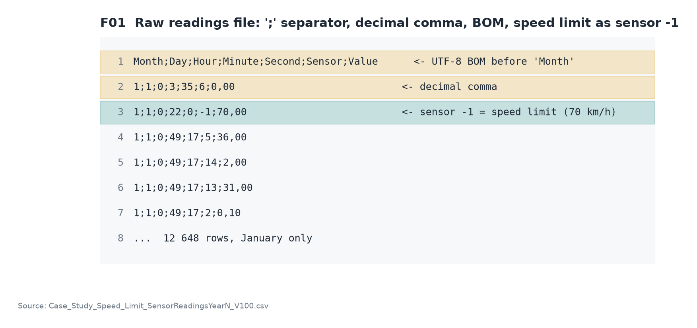
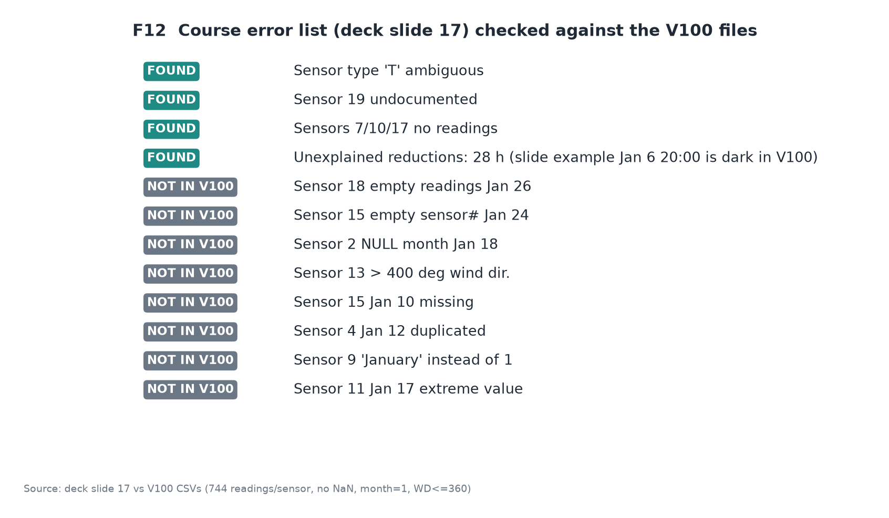
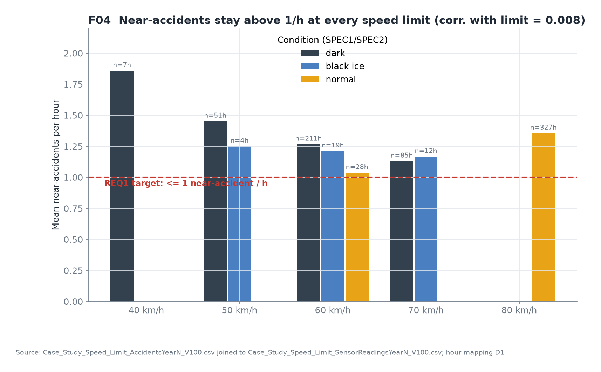
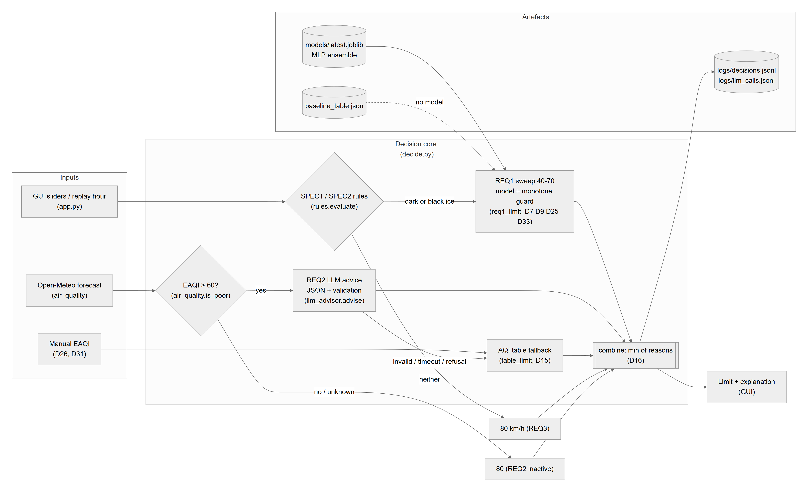
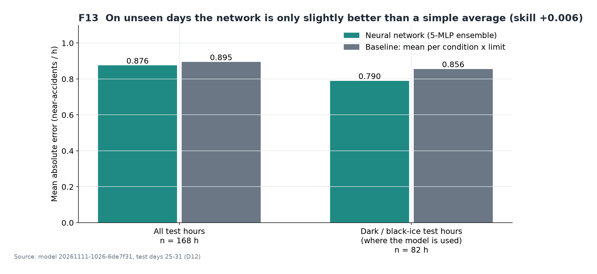
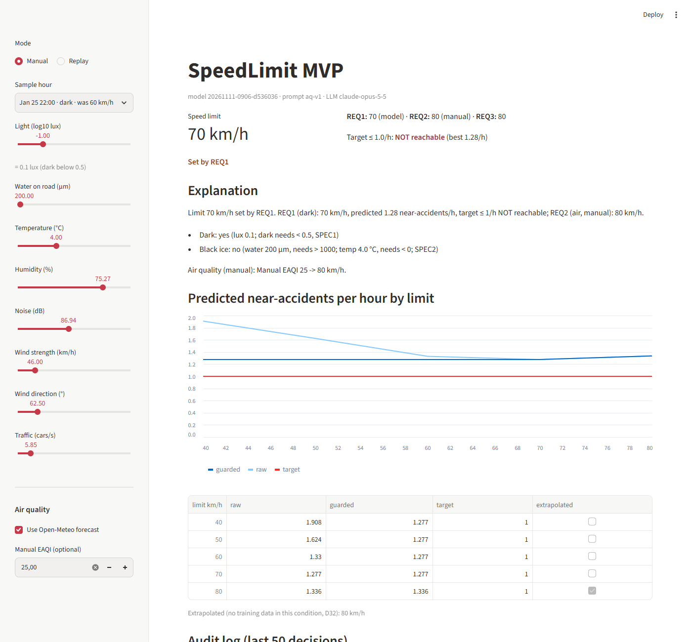
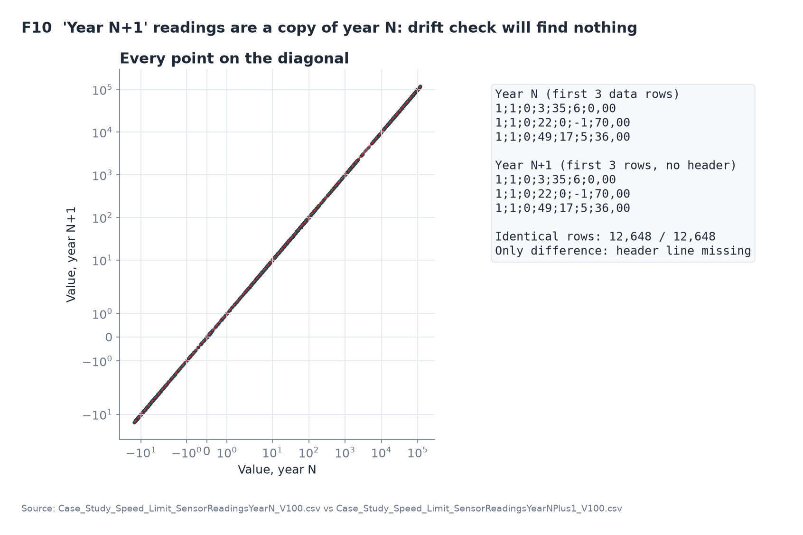

# 08 · Final Presentation Storyline (Management)

| | |
|---|---|
| Project | SpeedLimit MVP (SE4AI, ExID SpeedLimit21) |
| Document | Slide-by-slide outline for the final management presentation |
| Owner | Project Lead |
| Status | Draft, 2026-11-10. Data and requirements slides are final. Build results filled in on 2026-11-11 (Task 10). |
| Audience | Highway operator management (and the lecturer acting as management) |
| Length | ~15 minutes talk + Q&A, 16 slides |
| Sources | Main exercise brief (slide 32), case study slides, `05-decision-log.md` (D1–D20), `figures/facts.json`, figures F01–F12 |
| Keep | This deck is kept for the 3rd semester (brief, slide 32). |

## Ground rules for the deck

- Every headline is an assertion a manager can agree or disagree with. No topic labels like "Data".
- Only numbers from `figures/facts.json` or from the final training run. No rounded-up claims.
- One figure per slide, maximum. If a slide needs two figures, it is two slides.
- Bad news is told early and plainly (slide 6). The rest of the deck explains what we did about it.
- Slides marked **TODO-after-build** must not be shown with placeholder text. If a number is missing on the day, say so out loud.

## Timing plan

| Block | Slides | Minutes |
|---|---|---|
| Problem, scope, inputs | 1–3 | 2.0 |
| Requirements and data findings | 4–6 | 4.0 |
| Solution and results | 7–9 | 3.0 |
| Live demo | 10 | 2.5 |
| Retraining, risks, lessons, asks | 11–16 | 3.5 |
| **Total** | | **15.0** |

---

## Slide 1 — An MVP that sets the highway speed limit from weather, light and air quality is built and running

- **Key message:** We delivered a working MVP, and we also found that the data cannot prove the main safety target.
- **Content:**
  - Project name, team, date, course SE4AI.
  - One-line outcome: "Working end to end (training + operational GUI). REQ1 target is not supported by the January data, and we show why."
  - Agenda in one line: problem → data → requirements check → solution → demo → decisions needed.
- **Figure:** none (title slide).
- **Speaker notes:** Good morning. In the next fifteen minutes we show you a working prototype that recommends a speed limit for the highway. We also bring one uncomfortable finding about the safety target, and we will ask you for two decisions at the end.

## Slide 2 — The operator wants fewer near-accidents and cleaner air without slowing traffic when it is not needed

- **Key message:** Three requirements drive the system: reduce in darkness or black ice (REQ1), reduce for poor air (REQ2), otherwise 80 km/h (REQ3).
- **Content:**
  - REQ1: dark or black-ice danger → reduce so that on average at most 1 near-accident per hour.
  - REQ2: poor air quality predicted → reduce "appropriately" (LLM decides, no training data).
  - REQ3: no reason → 80 km/h.
  - SPEC1: dark = illuminance < 500 millilux. SPEC2: black ice = water > 1000 µm and temperature < 0 °C.
  - MVP scope: no sensors, no production deployment; a GUI replaces the sensors (brief, slide 32).
- **Figure:** none, or a simple three-box graphic (REQ1 / REQ2 / REQ3).
- **Speaker notes:** The brief from the operator is simple. In darkness or black ice, lower the limit far enough to keep near-accidents at one per hour or less. If bad air is forecast, lower it as well. Otherwise leave it at 80.

## Slide 3 — We received one month of hourly sensor data and an incident log, in a raw and partly inconsistent format

- **Key message:** The input is 744 hours of January data from 19 sensor IDs plus 997 incident rows, and the files needed parsing work before any analysis.
- **Content:**
  - SensorReadings: 12,648 rows, January only, one reading per sensor per hour (744 h).
  - Speed limit is stored as a fake sensor (ID −1). Format: `;` separator, decimal comma, UTF-8 BOM.
  - Accidents file: 997 rows = 964 near-accidents + 32 accidents + 1 empty row.
  - Sensors and SensorTypes: 18 sensors defined, 9 sensor types.
  - Second readings file labelled "year N+1" (used on slide 11).
- **Figure:** `figures/F01_raw_readings_format.png`

  

- **Speaker notes:** This is what we were given: one month of hourly readings and a log of incidents. The speed limit itself hides inside the sensor file as sensor minus one. One month is enough to build a prototype, but it is not enough to say anything about other seasons.

## Slide 4 — We turned three vague requirements into testable specifications, assumptions and a glossary

- **Key message:** The requirements work (stakeholders, completed REQs/SPECs, assumptions, glossary, NFRs, NL-error review) closed the gaps that would otherwise have blocked implementation.
- **Content:**
  - Stakeholders: operator management, traffic control operators, drivers, residents (air quality), police/road authority, data protection officer, maintenance.
  - Natural-language errors fixed, e.g. "appropriate way" (REQ2) → explicit allowed limits {40…80, step 10} and a fallback table (D14, D15); "on average" → per hour, measured over the test period.
  - Completed rules: combine reasons with **min** (D16); deterministic rules run as code, not in the network (D5).
  - Key assumptions logged in the decision log: hour alignment (D1), code T split (D2), near-accident definition (D6).
  - NFRs: safety (fallback when LLM fails), explainability (GUI shows reason and source), privacy (licence plates dropped, D20), testability (unit tests on injected faults, D19).
- **Figure:** none. Optional: one table "vague phrase → testable spec" with 3 rows.
- **Speaker notes:** The original requirements were short and partly vague. "Reduce in an appropriate way" cannot be tested, so we defined exactly which limits are allowed and what happens if the AI service is down. Every assumption we made is written down with an ID, so you can challenge any one of them.

## Slide 5 — The data had real defects, but most of the expected error list was not present in our file version

- **Key message:** We found four real defects in the V100 files; eight of the twelve errors on the course list were not in our version, so we test those repairs on injected faults instead.
- **Content:**
  - Code `T` used for both temperature and traffic. Sensors 15/18/19 behave as temperature (corr. ≥ 0.996); sensor 16 behaves as traffic (corr. 0.21 with sensor 15) (D2, F06).
  - Sensors 7, 10, 17 defined but never report; sensor 19 reports but is undocumented (D3, F03).
  - Clock mismatch: accidents use hours 1–24 (44 events at hour 24), readings 0–23 → shift by one (D1, F05).
  - 28 hours with a reduced limit under normal conditions, which contradicts REQ3 (D10, F07).
  - Smaller issues: unit typo "hm/h", padded unit, trailing space in code `W`.
  - Course error list: 4 found, 8 not in V100 → repairs still implemented and unit-tested (D19).
- **Figure:** `figures/F12_slide17_claims_check.png` (backup: F02, F03, F05, F06, F07)

  

- **Speaker notes:** We checked every expected data error against the files we actually got. Four were real, the rest were not in this version, and we still built and tested the repairs so the pipeline works on other versions. The most important real defect is that one sensor code means two different things, which we resolved by looking at how the signals behave.

## Slide 6 — The data does not show that lowering the limit brings near-accidents below one per hour

- **Key message:** At every observed speed limit and condition the average stays above 1 near-accident per hour, so REQ1 as written is not supported by this data. **(Hero slide.)**
- **Content:**
  - Overall: 964 near-accidents in 744 h = 1.3 per hour.
  - Correlation between speed limit and near-accidents per hour: 0.008, so practically none.
  - Dark: 1.86/h at 40 km/h (7 h), 1.45 at 50, 1.27 at 60, 1.13 at 70.
  - Black ice: 1.25 at 50, 1.21 at 60, 1.17 at 70.
  - Lowest cell: 1.04/h (normal conditions at 60 km/h, only 28 h).
  - Lower limits coincide with **more** incidents. Most likely reason: operators lower the limit when conditions are already worse (confounding), not that slower driving is more dangerous.
- **Figure:** `figures/F04_req1_near_accidents_vs_speed.png`

  

- **Speaker notes:** This is the most important slide. The red line is your target of one near-accident per hour, and no bar gets below it, at any speed limit, in any condition. The bars even go up when the limit goes down, which we read as operators reacting to worse conditions, not as proof that slower is less safe. So the data we have cannot show that the target is reachable by speed limits alone.

## Slide 7 — We built REQ1 as specified anyway, with guard rails that keep it honest and safe

- **Key message:** The model predicts near-accidents per limit, picks the highest limit that meets the target, and openly flags when no limit does.
- **Content:**
  - Model learns near-accidents per hour from weather features + speed limit (count regression, small neural network, D7, D18).
  - At runtime: try 40/50/60/70/80, choose the highest limit predicted ≤ 1.0; if none qualifies, choose the highest limit within 0.05/h of the best and show "target not reachable" (D7, D25).
  - Monotonicity guard: a lower limit can never be predicted as more dangerous (D9). Stops the model learning "drive faster to be safer" from confounded data.
  - Transparency: GUI shows predicted rate, chosen limit and the flag (D8).
  - Features: log lux, water, temperature, humidity, noise, wind (strength, direction as sin/cos), traffic, hour of day; licence plates dropped (D11, D20, F08).
- **Figure:** `figures/F08_lux_log_transform.png` (small, bottom right) or none.
- **Speaker notes:** We did not quietly change your requirement. We built it exactly as specified, and we made the system say clearly when the target cannot be met. We also added a safety rule so that the model can never recommend driving faster because of a pattern in the old data.

## Slide 8 — A simple router keeps rules in code and uses AI only where the requirements ask for it

- **Key message:** Deterministic rules decide *whether* to reduce; the neural network decides *how much* for REQ1; an LLM with a fixed fallback handles REQ2; the strictest result wins.
- **Content:**
  - Inputs: GUI sensor values (or replayed CSV hour) + Open-Meteo air-quality forecast.
  - Router: dark or black ice (SPEC1/SPEC2, plain code) → REQ1 model. Poor air forecast → REQ2 LLM. Neither → 80 km/h (REQ3).
  - REQ2: LLM returns JSON `{speed_limit, reason}`; on timeout, error or invalid output → deterministic EU-AQI table (≤ 60 → 80, 61–80 → 70, 81–100 → 60, > 100 → 50) (D14, D15).
  - Combine: final limit = min(REQ1 result, REQ2 result, 80) (D16).
  - Output: limit + reason + source (model / LLM / fallback / rule) shown in the GUI.
- **Figure:** `figures/U02_component_router.png` (component diagram from `10-uml.md`).

  

- **Speaker notes:** The system is a router. Simple rules like "is it dark" stay as plain code, because they are defined exactly in the specification. The neural network only decides how much to reduce at night or in black ice, and the language model only handles air quality, with a fixed table behind it if it fails.

## Slide 9 — The network is only slightly better than a simple average, and the ≤ 1/h target is reachable in 33 % of reduction hours

- **Key message:** On the unseen last week the network beats the simple average a little (most where it is used: dark/ice hours), reaches the REQ1 target in 33 % of those hours, and needed the guard every time.
- **Content (test set = days 25–31, D12, model `20261111-0906`):**
  - Model error (MAE near-accidents/h): **0.876** vs baseline (mean per condition × limit) **0.895** on all 168 test hours; **0.790 vs 0.856** on the 82 dark/ice hours.
  - Share of dark/ice test hours where a limit ≤ 70 km/h is predicted ≤ 1.0: **32.9 %**; "target not reachable": **67.1 %** (after the final-review fix that keeps the extrapolated 80 km/h value out of the guard).
  - Recommended limits vs operators (82 h): system 70 ×64, 60 ×17, 50 ×1 · operators 70 ×19, 60 ×55, 50 ×8 (F14). The system reduces less than the operators did.
  - Monotonicity guard changed the raw curve in **100 %** of dark/ice test hours: unguarded, the network always rated faster as safer (+0.435/h more at 40 than at 80 km/h).
  - REQ2: live forecast works (Vienna EAQI 45 → no reduction); live LLM call not yet run (no API key on the build machine) — LLM path and all fallbacks covered by 15 unit tests.
  - Tests: **172 passing** (incl. injected slide-17 faults and offline GUI tests).
- **Figure:** `figures/F13_model_vs_baseline.png` (and F14 in the appendix).

  

- **Speaker notes:** On the last week, which the model never saw, it is slightly better than a simple average, a bit more so in the dark and icy hours where it is actually used. That is what we expected after slide six. And notice the guard number: left alone, the network would have told us to drive faster every single time, because that is what the history looks like. The guard stops exactly that.

## Slide 10 — Live demo: three situations, three different decisions

- **Key message:** The operator enters conditions and gets a limit with a readable reason in seconds.
- **Content (demo script, ~2.5 min):**
  1. **Normal daytime** (lux high, dry, +5 °C, good air) → 80 km/h, source "rule (REQ3)".
  2. **Dark night** (lux 0.1) → model result, e.g. 60 or 70 km/h, predicted rate shown; if no limit reaches ≤ 1.0, the red "target not reachable" flag appears.
  3. **Black ice + poor air** (water 1500 µm, −3 °C, AQI forecast high) → min of REQ1 and REQ2 shown, both reasons listed.
  4. **Failure case:** switch off network / invalid API key for the LLM → fallback table used, source label changes to "fallback".
  5. Optional: start auto-refresh replay from the CSV and let the limit update on the timer (D17).
- **Figure:** backup screenshots `evidence/screenshots/S01…S08` (one per scenario). Deep links `http://localhost:8501/?scenario=AT-1` … `AT-8` open each scenario directly.

  

- **Backup plan:** pre-recorded 60-second screen capture and the four screenshots in the appendix.
- **Speaker notes:** Let me show you how an operator would use this. First a normal day, then a dark night, then black ice with bad air at the same time. Finally I cut the connection to the AI service to show that the system still gives a safe answer from a fixed table.

## Slide 11 — No retraining is needed, because the "year N+1" file is an exact copy of year N

- **Key message:** All 12,648 readings in the year N+1 file are identical to year N; the drift check confirms no change, and the check is ready for real new data.
- **Content:**
  - Row-by-row comparison: 12,648 / 12,648 identical; only difference is the missing header line.
  - Drift check per feature (KS test + mean shift, D13): **no drift on all 12 features** (every KS statistic 0), verdict **no_retrain**, duplicate-dataset warning (`evidence/drift_report.md`).
  - Verdict: no retraining.
  - Caveat: this says nothing about a real next year. Both files are January only.
  - Retraining triggers for the future: drift on any key input, near-accident rate change, new sensors, new season.
- **Figure:** `figures/F10_yearN1_identical.png`

  

- **Speaker notes:** We were asked whether the model needs retraining on next year's data. The file we got for next year is the same file as this year, value for value, so the answer is no. We built the drift check anyway, so when real new data arrives it runs automatically and tells you if retraining is due.

## Slide 12 — The main risks are thin data, confounding and dependence on an external AI service

- **Key message:** Each risk has a mitigation in the MVP, but two of them need management action before production.
- **Content:**

  | Risk | Impact | Mitigation in MVP | Needs management? |
  |---|---|---|---|
  | One month of data (January only) | Model unknown for other seasons | Scope limited to winter; drift check | Yes: collect more data |
  | Confounding (limit set because of conditions) | Model cannot learn the real effect of the limit | Monotonicity guard, transparency flag | Yes: controlled trial |
  | REQ1 target not reachable | System cannot promise ≤ 1/h | "Target not reachable" flag | Yes: revisit target |
  | LLM wrong / unavailable / cost | Wrong or missing REQ2 limit | Fixed JSON output, fallback table, source label | No |
  | Ambiguous sensor metadata (code T, sensor 19) | Wrong input mapping | Behaviour-based mapping (D2), documented | Fix master data |
  | 28 unexplained manual reductions | Noise in training data | Kept, flagged, never output (D10) | Ask operators why |
  | Privacy (licence plates) | GDPR exposure | Dropped at load (D20) | No |

- **Figure:** none (table).
- **Speaker notes:** These are the risks we see. Most are handled inside the prototype. Two are not technical: we need more than one month of data, and we need a way to measure the real effect of the speed limit, because historical data alone mixes up cause and effect.

## Slide 13 — Lessons learned: check the data against the requirement before building the model

- **Key message:** The most valuable work was the early data analysis that showed what the requirements can and cannot promise.
- **Content (top five, detail in `09-lessons-learned.md`):**
  - Look at the target versus the data first: F04 changed the story of the project.
  - Ambiguous metadata is normal; decide from signal behaviour and write it down (code T).
  - Keep exact rules in code and AI where there is no rule (router design).
  - An external LLM in a safety path needs a deterministic fallback from day one.
  - AI-assisted coding (Claude Code) speeds up build and analysis, but every number still has to be verified: the first recon claimed a duplicated `WD` line in SensorTypes; a mutation-checked test showed the line exists only once.
- **Figure:** none.
- **Speaker notes:** If we did this again, we would do the data-versus-requirement check on day one, because that single chart reshaped the whole project. We also learned that writing down every assumption saves time later, because nobody has to remember why a choice was made.

## Slide 14 — What the MVP delivers today, and what it does not

- **Key message:** Clear scope boundary so nobody mistakes the MVP for a production system.
- **Content:**
  - Delivers: data cleaning pipeline with tests, trained neural network, router, REQ2 with LLM and fallback, GUI with manual and replay mode, drift check.
  - Does not deliver: real sensor connection, production deployment, proof that REQ1 is achievable, validation outside January, operator user testing.
  - Status of each exercise: RE ✔, architecture ✔, data preparation ✔, cleaning code ✔ (rules C04–C16, tested on injected faults), retraining analysis ✔, implementation ✔ (training stage, GUI, REQ2; live LLM sample pending an API key).
- **Figure:** none (two-column list).
- **Speaker notes:** To be precise about what you are getting: a prototype that works end to end on historical data. It is not connected to real sensors, and it has only seen one winter month.

## Slide 15 — We ask management for three decisions

- **Key message:** Three concrete decisions unlock the next phase.
- **Content:**
  1. **Revisit the REQ1 target.** Either accept "as low as achievable, with a flag" or define a reachable target (e.g. a relative reduction) together with traffic safety experts.
  2. **Fund data collection** for at least a full year, including summer and autumn, before any production decision.
  3. **Approve a controlled trial** on one highway section (alternating limits under the same conditions) to measure the real effect of the speed limit, removing the confounding.
  - Also: ask operators to document the reason for each manual reduction (would explain the 28 cases).
- **Figure:** none.
- **Speaker notes:** We need three decisions from you. First, whether the one-per-hour target stays as it is. Second, whether we can collect a full year of data. Third, whether we may run a small controlled trial, because that is the only reliable way to find out how much the speed limit really changes safety.

## Slide 16 — Next steps for the 3rd semester

- **Key message:** The deck, code and decision log carry over; the next phase is data, trial design and hardening.
- **Content:**
  - Re-run the pipeline and drift check on any new data version.
  - Replace manual GUI input with a sensor feed or data-platform connection.
  - Evaluate REQ2 decisions with domain experts; log every LLM decision for audit.
  - Add monitoring: near-accident rate per limit, fallback rate, drift alerts.
  - Thank you / questions.
- **Figure:** none.
- **Speaker notes:** This presentation and the code stay with the project for next semester. The next steps are more data, a trial, and connecting real inputs. Thank you, we are happy to take questions.

---

## Appendix slides (backup, show only if asked)

| # | Title | Figure |
|---|---|---|
| A1 | Code T means two things; behaviour tells them apart | `figures/F02_sensor_types_issues.png`, `figures/F06_sensor16_traffic_vs_temperature.png` |
| A2 | Three sensors never report, one reports without a description | `figures/F03_sensor_coverage.png` |
| A3 | The two files use different clocks; we shift accidents by one hour | `figures/F05_hour_mismatch.png` |
| A4 | 28 reductions happen with no SPEC reason | `figures/F07_unexplained_reductions.png` (shows Jan 11–14 only) |
| A5 | Light needs a log scale to be a useful input | `figures/F08_lux_log_transform.png` |
| A6 | 89% of near-accidents are "too close to another car" | `figures/F09_event_composition.png` |
| A7 | One week of inputs, limits and incidents side by side | `figures/F11_week_overview.png` |
| A8 | Full decision log D1–D33 | table from `05-decision-log.md` |
| A9 | GUI screenshots for each demo scenario | `evidence/screenshots/S01…S08` |
| A10 | System REQ1 choices vs operator limits | `figures/F14_req1_choices_vs_operators.png` |

## TODO-after-build checklist

- [x] Slide 8: router diagram exported (`figures/U02_component_router.png`).
- [x] Slide 9: numbers filled from `evidence/model_results.json`; headline rewritten.
- [x] Slide 10: eight GUI screenshots captured. [ ] 60 s screen recording still to record by hand.
- [x] Slide 11: drift-check output inserted.
- [x] Slide 13: example added.
- [x] Slide 14: status confirmed.
- [ ] Live LLM sample once an API key is available (`evidence/acceptance_run.md`).
- [ ] Dry run with a timer; cut content if over 15 minutes, never speed up.

## Q&A prep

**1. If the model cannot meet the target, why ship it?**
Because the target is a property of the road, not of the model. The data shows no limit reaching ≤ 1/h (F04). The system still picks the lowest-risk option it can find, says honestly when the target is out of reach, and never recommends going faster because of the guard. Shipping the MVP with that flag is more useful than pretending, and it gives you the evidence to revisit the target.

**2. Your data shows lower limits with more near-accidents. Shouldn't we just raise the limit?**
No. The limit was lowered by operators *because* conditions were bad, so bad conditions drive both. The data cannot separate the two effects. That is why we added the monotonicity guard and why we ask for a controlled trial.

**3. One month of data. How can you trust any of this?**
We trust it for what it is: a January prototype. We do not claim validity for other seasons, and the drift check will flag when new data differs. A full year of data is one of our three asks.

**4. Why use a neural network at all if correlation is 0.008?**
The brief requires a neural network for the training stage. We kept it small (744 rows) and compare it against a simple average baseline on unseen days, so you can see whether it adds anything. Result: slightly better on unseen days (MAE 0.876 vs 0.895; 0.790 vs 0.856 in dark/ice hours). The architecture lets us swap it for a simpler model without touching the rest.

**5. What happens if the LLM gives a dangerous answer or the API is down?**
The LLM can only return one of five allowed limits in a fixed JSON format; anything else is rejected. On error, timeout or invalid output, a fixed AQI table decides. The final limit is the minimum of all reasons, so the LLM can only make the limit stricter, never raise it above what REQ1 demands.

**6. Why did you decide the ambiguous sensor code yourselves instead of asking?**
We documented it instead of waiting: sensors 15, 18 and 19 move together around 0 °C (corr. ≥ 0.996), sensor 16 ranges 1.85–30 and matches traffic, not temperature (corr. 0.21). It is logged as D2 and easy to reverse if the master data owner says otherwise.

**7. Why is retraining not needed, and isn't that suspicious?**
The year N+1 file is the year N file again, all 12,648 rows identical. So "no retraining" is correct for that file but tells us nothing about a real next year. We report it as a data-delivery issue, and the drift check is ready for real data.

**8. How much of this was written by AI, and how do you know it is correct?**
We used Claude Code with structured skills (planning, test-driven development, verification) for coding and analysis. Every reported number comes from `facts.json` or the training run, every data repair has a unit test, and figures were checked against the raw files. AI wrote code faster; it did not decide the findings.

**Spare questions to rehearse:** What about the 32 real accidents, why not use them? (Too few, counted and reported separately, D6.) Why not delete the 28 odd hours? (Real observations; deleting hides a data issue, D10.) Where is the highway, for the air-quality API? (Assumed location, configurable.)
