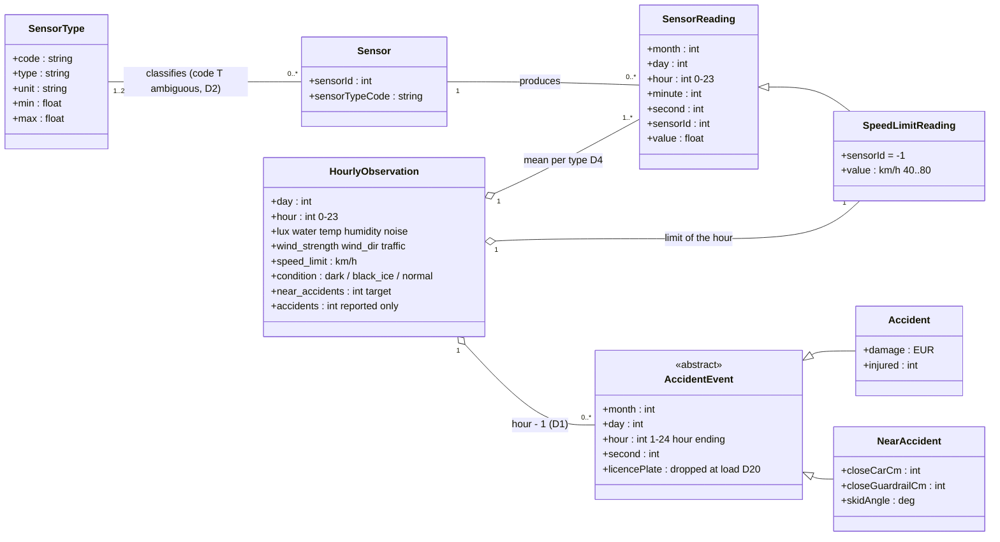
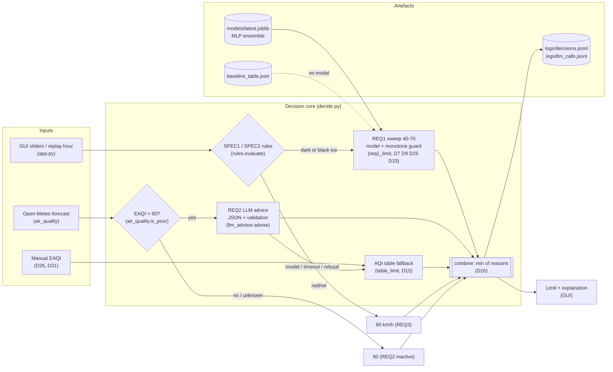
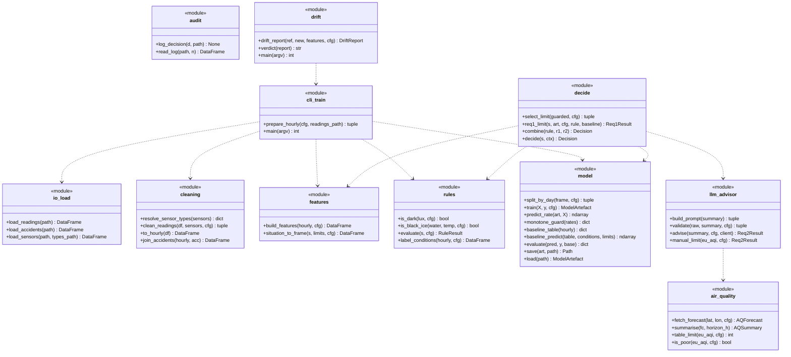
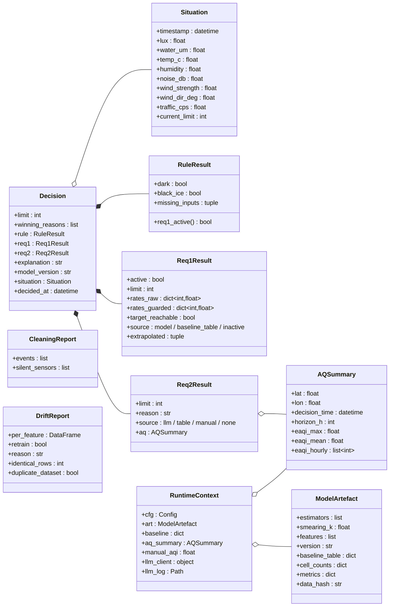
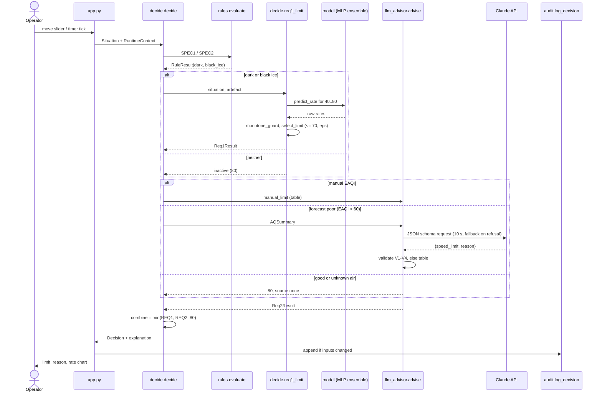
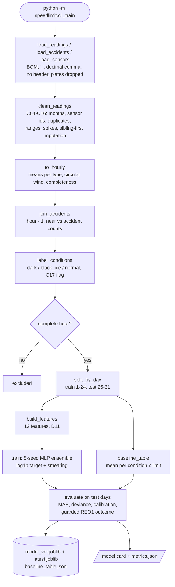
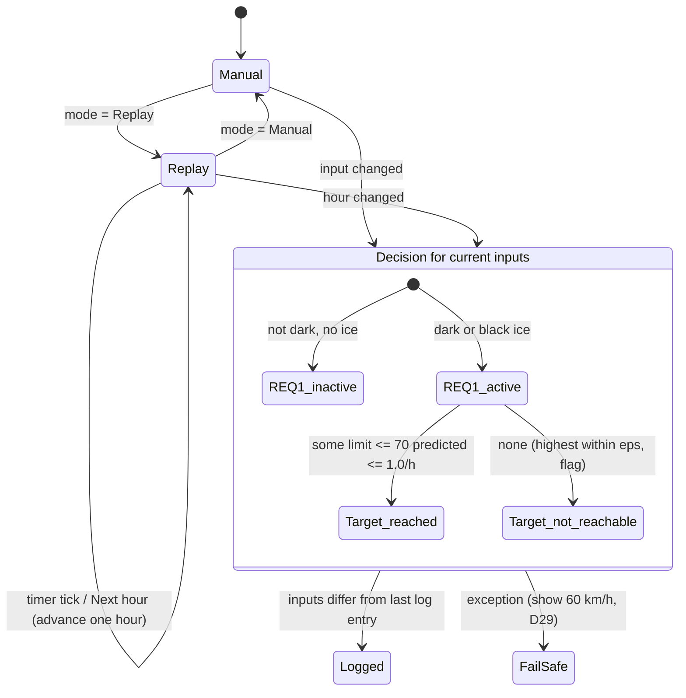

# 10 · UML Diagrams

| | |
|---|---|
| Document | UML set for the SpeedLimit MVP (exercise "class diagram", deck slide 16; "architecture diagram with router", slide 15) |
| Version | 1.0 · 2026-11-11 · reflects branch `build/mvp` |
| Owner | Architecture |
| Check | `tests/unit/test_uml.py` verifies that every type, field and module function named in U02M and U03 exists in the code |
| Images | `figures/U01…U06*.png`, rendered by `analysis/render_uml.py` |

| ID | Diagram | UML type | Answers |
|---|---|---|---|
| U01 | Data model | Class | What do the course files contain and how do they relate? |
| U02 | Router architecture | Component (flowchart notation) | Which parts decide the limit, and how? |
| U02M | Module interfaces | Class (modules as «module») | Which functions does each module offer? |
| U03 | Domain types | Class | Which values flow through a decision? |
| U04 | Decision cycle | Sequence | What happens when an operator changes an input? |
| U05 | Training stage | Activity | How do raw CSVs become a model artefact? |
| U06 | GUI and REQ1 states | State machine | Which modes and REQ1 outcomes exist? |

---

## U01 · Data model (course files, V100)

<!-- U01 -->

Notes: sensor 19 reports but is not in `Sensors.csv` (mapped to temperature, D3); sensors 7, 10, 17 are documented but silent. `SensorType` code `T` matches two rows, hence the `1..2` multiplicity.

## U02 · Router architecture

<!-- U02 -->

## U02M · Module interfaces

<!-- U02M -->

## U03 · Domain types

<!-- U03 -->

## U04 · Decision cycle (operator changes an input)

<!-- U04 -->

## U05 · Training stage

<!-- U05 -->

## U06 · GUI and REQ1 states

<!-- U06 -->

